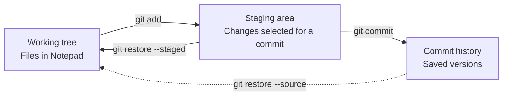
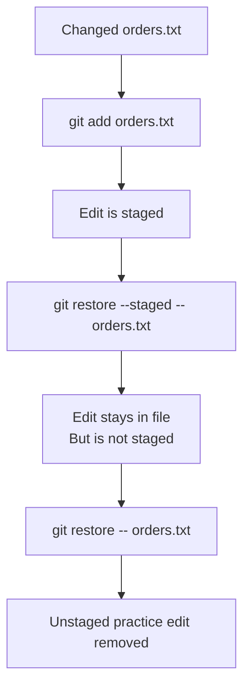
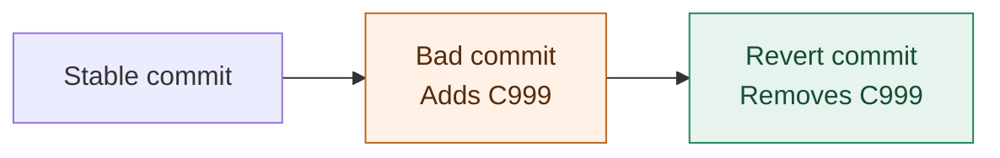
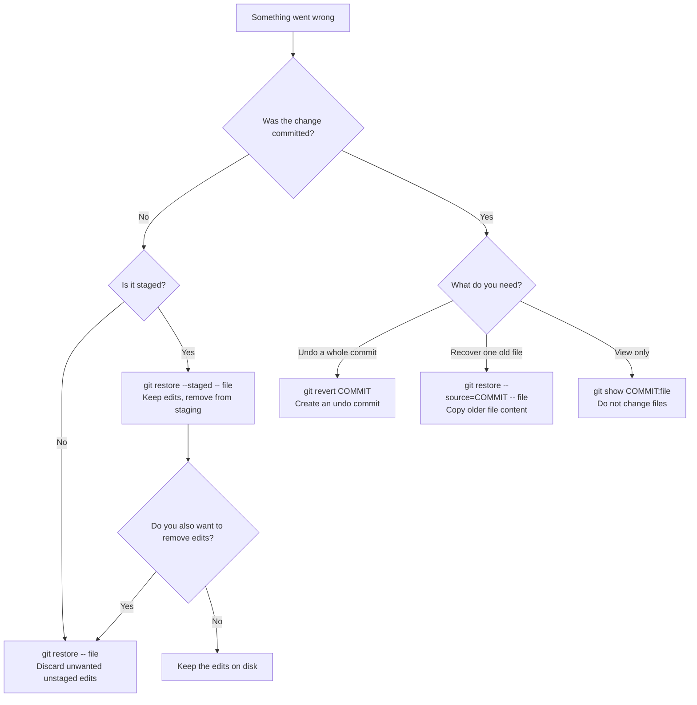

# Git Session 2 — Fix Mistakes and Recover Files

**Use:** Git Bash and Notepad  
**Practice files:** `customers.txt` and `orders.txt`  
**Work locally:** No GitHub account or internet connection is needed.

In this lesson, you will fix mistakes in three places: files on your computer, changes selected for the next commit, and changes already saved in a commit.

## 1. Find out where the mistake is



| Term | Simple meaning |
|---|---|
| **Working tree** | The files you open and edit in Notepad. |
| **Staging area** | The file changes you have selected for your **next** commit. |
| **Unstage** | Remove a change from that selection. The edit **stays in the file** on your computer. |
| **Commit** | A saved version in Git history. |
| **HEAD** | Your current place in Git history, usually through the current branch. |

A useful habit is to run `git status` before and after changing anything. It tells you whether Git sees new files, modified files, staged changes, or deletions.

---

## 2. Check your practice files

Continue in the Git repository used in the previous lesson. Both files below must **already be committed**. They may have more lines than these examples.

**`customers.txt`**

```text
C101,Anaya,Active
C102,Rahul,Active
```

**`orders.txt`**

```text
O101,C101,1500
O102,C102,2200
```

If either file is missing, create it in Notepad using the example content. Run `git add customers.txt orders.txt` to select both files, then `git commit -m "Save starting practice files"` to save the starting version. Run that commit only if Git reports changes to commit.

| In Git Bash | What it tells you |
|---|---|
| `git status` | Shows whether you have unfinished file changes. Start the exercises with a clean working tree. |
| `git log --oneline -3` | Shows the latest three saved versions, with short commit IDs. |

If the previous lesson left you at an old commit with a **detached HEAD**, return to your normal branch first (for example, `git checkout main`, if that branch is named `main`). This returns you to the branch version without removing later commits. Do not switch while you have unfinished edits.

---

## 3. Mistake: You changed a file but do not want the edit

Open `customers.txt` in Notepad, add this line, and save the file:

```text
C999,Wrong Customer,Invalid
```

| In Git Bash | What happens |
|---|---|
| `git diff -- customers.txt` | Shows your edits that have **not** been staged. Look for the new `C999` line. |
| `git restore -- customers.txt` | Puts the file back to its staged version. Because you did not stage this edit, the unwanted line is removed. |
| `git diff -- customers.txt` | Shows no difference if the unwanted edit is gone. |

**Open the file again:** `C999` should be missing. Be careful: this restore command discards unstaged edits in the selected file.

---

## 4. Mistake: You selected the wrong file for the next commit

Open `orders.txt`, add the following line, and save:

```text
O999,C999,9999
```

| In Git Bash | What happens |
|---|---|
| `git add orders.txt` | Copies the current file content into the staging area so it is ready for the next commit. |
| `git diff --staged -- orders.txt` | Shows the change selected for the next commit. |
| `git restore --staged -- orders.txt` | **Unstages** the file. The added line stays in Notepad, but it is no longer selected for the next commit. |
| `git diff -- orders.txt` | Shows the added line as an unstaged change, proving it was not deleted. |
| `git restore -- orders.txt` | Removes the practice edit from the file, so the next exercise starts clean. |



**Check:** After unstaging, you can still see `O999` in Notepad. After the final restore, `O999` is gone.

---

## 5. Mistake: You deleted an important file

Delete `orders.txt`. You can delete it in File Explorer or use `rm orders.txt` in Git Bash; `rm` removes the file from your computer.

| In Git Bash | What happens |
|---|---|
| `git status` | Shows `orders.txt` as deleted because Git remembers the file. |
| `git restore -- orders.txt` | Brings the file back from the staged version, normally the latest commit. |
| `git status` | Confirms the deletion is no longer waiting to be saved. |

**Open the folder:** `orders.txt` should be back. Git can do this because the file was committed before. It cannot restore a never-committed, untracked file this way.

---

## 6. Mistake: You already committed incorrect data

Open `customers.txt`, add `C999,Wrong Customer,Invalid`, and save.

| In Git Bash | What happens |
|---|---|
| `git add customers.txt` | Selects the incorrect edit for the next commit. |
| `git commit -m "Add incorrect customer"` | Saves a new commit containing the mistake. |
| `git revert --no-edit HEAD` | Makes a **new commit** that reverses the most recent commit. `HEAD` means the currently checked-out commit. The wrong customer disappears from the latest file. |
| `git log --oneline -3` | Shows both the mistaken commit and the new commit that undid it. |
| `git show HEAD~1` | Shows the mistaken commit. `HEAD~1` means one commit before the current commit. |



**Important:** `git revert` does not erase the bad commit. It adds another commit to cancel the bad change. You can still inspect the bad commit in the history.

### What if the committed mistake was a file deletion?

Delete `orders.txt` again, then follow this sequence:

| In Git Bash | What happens |
|---|---|
| `rm orders.txt` | Deletes the file on your computer. Skip this command if you deleted it using File Explorer. |
| `git add -u` | Stages edits and deletions to **already tracked** files, including the missing `orders.txt`. |
| `git commit -m "Delete orders by mistake"` | Saves the accidental deletion as a commit. |
| `git revert --no-edit HEAD` | Makes a new commit that reverses the deletion. The file returns. |
| `git log --oneline -3` | Shows the deletion commit and the commit that recovered the file. |

**Check:** `orders.txt` should be back, and its original lines should still be present.

> **About accidentally committed secrets:** A revert does not remove a password or secret from older commits. If a real credential was exposed, revoke or rotate it. Do not use real credentials in practice files.

---

## 7. Recover only one file from an older commit

Open `customers.txt`, add this valid line, and save:

```text
C105,Kiran,Active
```

| In Git Bash | What happens |
|---|---|
| `git add customers.txt` | Selects the new line for the next commit. |
| `git commit -m "Add customer Kiran"` | Saves a version of the file containing Kiran. |
| `git show HEAD~1:customers.txt` | **Displays** the previous committed file in Git Bash. It does not change the Notepad file. |
| `git restore --source=HEAD~1 -- customers.txt` | **Copies** the older file into your working tree. `HEAD` does not move, and other files are not changed. |
| `git diff -- customers.txt` | Shows how the restored file differs from the current staged version. |
| `git add customers.txt` | Selects the restored file for a new commit. |
| `git commit -m "Restore previous customer list"` | Saves the restored file as the latest version. |
| `git log --oneline -4` | Shows that the commit adding Kiran still exists in history. |

```mermaid
flowchart TD
    A[Current commit has Kiran] --> B{What do you want?}
    B -->|Only look at an older file| C[git show HEAD~1:customers.txt]
    B -->|Use an older file again| D[git restore --source=HEAD~1 -- customers.txt]
    D --> E[git add customers.txt]
    E --> F[git commit -m "Restore previous customer list"]
    C --> G[Working file stays unchanged]
    F --> H[New commit saves restored file]
```

To choose a different saved version, run `git log --oneline` to find its commit ID. Replace `HEAD~1` with that ID in the `git show` or `git restore --source` command.

## 8. Revisit an earlier commit — even a mistaken one

The accidental customer commit is still in history after the revert. You can **look at it** or **make its file content current again**.

| In Git Bash | What happens |
|---|---|
| `git log --oneline` | Lists saved commits. Find the ID next to `Add incorrect customer`. |
| `git show <commit-id>:customers.txt` | Shows the file from that mistaken commit, without changing your current files. |
| `git restore --source=<commit-id> -- customers.txt` | Copies that commit's customer file back into the working tree. This also brings back the incorrect line, so use this only for this practice example. |
| `git diff -- customers.txt` | Shows what changed compared with the staged copy. |
| `git add customers.txt` | Selects the recovered file content for the next commit. |
| `git commit -m "Revisit earlier customer version"` | Makes that file content the current committed version, while keeping the earlier history. |
| `git revert --no-edit HEAD` | Reverses the practice commit again, removing the bad line while keeping both commits in history. |

**Check:** The earlier mistaken commit is still visible with `git log --oneline`. Returning to a file's older content does not delete the commits made after it.

A committed deletion also stays in history after you reverse it. Use `git log --oneline` to find the deletion commit and `git show <commit-id>` to view which file was removed. Because `git revert` adds a new commit instead of deleting old commits, there is no automatic 30-day limit on these commits in normal history. The 30/90-day expiration defaults you may hear about apply to **reflog entries**, a separate recovery tool.

---

## 9. Choose the safe recovery path



**Remember:** Before any restore, check `git status` and `git diff` so you know which edits you could lose. The exercises use committed practice files; work you never committed may not be recoverable with Git.
