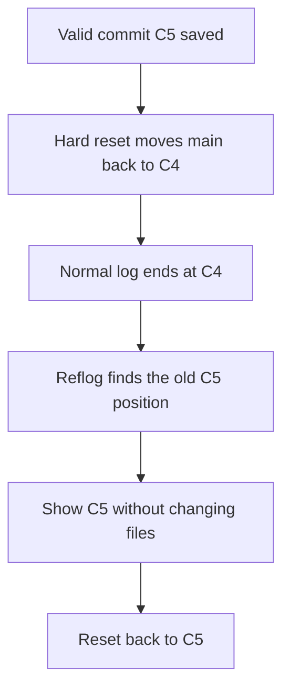
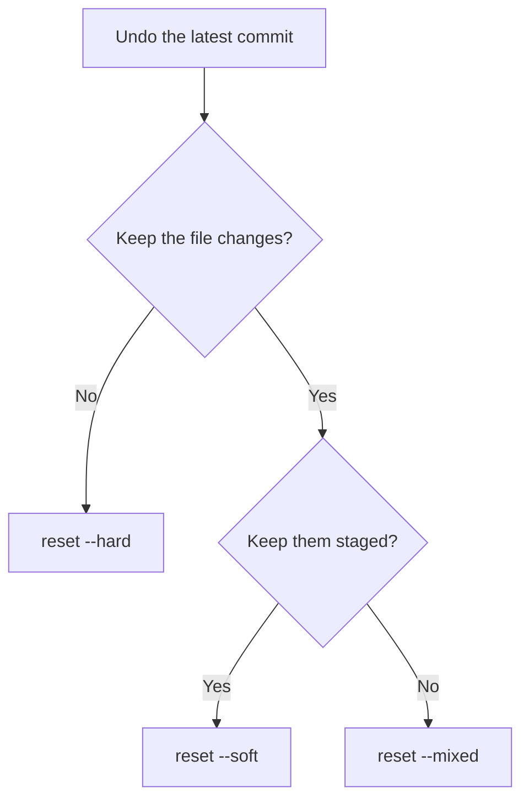

# Git Session 3 — Reset, Reflog, and Recovering Commits

**Tools:** Git Bash and Notepad  
**Practice files:** `customers.txt` and `orders.txt`  
**Work locally:** No GitHub connection is needed.

Git can save versions of your files. But what if you committed too early, want to remove your latest commit, or accidentally moved back and lost sight of an important commit?

In this lesson, you will practise three ways to reset a commit and use Git's local history of HEAD movements to find a commit again.

---

## 1. First, understand what can change


| Place | Simple meaning |
|---|---|
| **Working tree** | The actual files you open in Notepad. |
| **Staging area** | The saved selection of file content for your next commit. It is also called the **index**. |
| **Commit history** | Versions already saved by Git. |
| **HEAD** | The commit currently checked out. In this lesson, HEAD normally follows the `main` branch. |

After a normal commit, the staging area still contains the current file snapshot. Git says **nothing to commit** because staging and HEAD contain the same content.

**Remember the difference between these commands:**

| Command | What happens |
|---|---|
| `git show HEAD~1` | Displays information and changes from the parent of HEAD. Your files do not change. |
| `git checkout HEAD~1` | Visits the parent commit and usually changes the files on disk. HEAD becomes detached, but `main` does not move. |
| `git restore customers.txt` | Replaces the working-tree file with the staged version. It does not move HEAD. |
| `git restore --staged customers.txt` | Replaces the staged copy with the version in HEAD, keeping your working-tree edits. It does not move HEAD. |
| `git revert --no-edit HEAD` | Creates a **new** commit to undo the latest commit's changes. `--no-edit` uses the automatic commit message instead of opening an editor. |
| `git reset --soft HEAD~1` | Moves the current branch back one commit, but keeps the staging area and files unchanged. |

> **Important:** `git reset` works differently from checkout. In this lesson you are on `main`, so resetting a commit **moves `main` itself**. Checkout of a commit hash normally only changes which commit you are visiting.

---

## 2. Start with a separate practice repository

Use a new folder for this lesson. Later exercises use `--hard`, which can throw away file edits. Do not run those exercises in a real project.

| Git Bash command | What it does |
|---|---|
| `mkdir git-session-03` | Creates a folder for the exercises. |
| `cd git-session-03` | Moves into that folder. |
| `git init -b main` | Starts local Git tracking, with the starting branch named `main`. `-b main` chooses the branch name. |

Create **`customers.txt`** in Notepad and save these two lines:

```text
C101,Anaya,Active
C102,Rahul,Active
```

Create **`orders.txt`** and save:

```text
O101,C101,1500
```

Run:

```bash
git add customers.txt orders.txt
git commit -m "C1 - Save starting files"
```

`git add` selects both files for the commit. `git commit` saves them as **C1**. The `-m` option lets you provide the commit message directly.

Add one line to **`customers.txt`**, save, and commit:

```text
C103,Meera,Active
```

```bash
git add customers.txt
git commit -m "C2 - Add Meera"
```

Now add one more line to **`customers.txt`**, save, and commit:

```text
C104,Kiran,Active
```

```bash
git add customers.txt
git commit -m "C3 - Add Kiran"
git log --oneline -3
git status
```

`--oneline` shows each commit on a short line; `-3` limits the output to three commits. `git status` should show a **clean working tree**, meaning there are no unfinished tracked-file changes.


**Current result:** `customers.txt` contains Anaya, Rahul, Meera, and Kiran. HEAD is at C3.

---

## 3. Scenario 1 — Committed too early: `git reset --soft`

**Situation:** You committed Kiran, but you also want to include Kavya in that same commit. You want to undo the latest commit **without losing or unstaging** Kiran's change.

```bash
git reset --soft HEAD~1
git status
git diff --staged
```

- `reset` moves the current branch to a chosen commit.
- `--soft` means **do not change the staging area or the actual files**.
- `HEAD~1` means **the parent of the current commit** (one commit back), not the last position shown by reflog.
- `git status` shows Kiran's change as **staged**: selected for the next commit.
- `git diff --staged` compares the staged content with HEAD (now C2), so you can see Kiran's line waiting to be committed.

| Area after `--soft` | What it contains |
|---|---|
| HEAD / `main` | C2 — before Kiran |
| Staging area | Kiran's line is included |
| Working tree | Kiran's line is included |

Open `customers.txt` in Notepad. **Kiran is still there.** Add the following line and save:

```text
C105,Kavya,Active
```

```bash
git status
git diff
git diff --staged
```

The file now has two kinds of changes at once: Kiran is **staged**, but Kavya is **not yet staged**. `git diff` shows the unstaged Kavya line; `git diff --staged` shows the staged Kiran line.

Complete the corrected commit:

```bash
git add customers.txt
git commit -m "C3 - Add Kiran and Kavya"
git status
```

**Result:** The latest commit now contains both customers. The earlier Kiran-only commit is no longer on the current branch's history, although Git may still retain it temporarily.

> **Why not `git restore --staged`?** That command only removes file changes from staging. It does **not** undo an existing commit or move HEAD. `git reset --soft` does move the current branch.

---

## 4. Scenario 2 — Want to review committed work again: `git reset --mixed`

**Situation:** You committed a new order, but want to move the change back to the working tree, review it, and then commit it again.

Add this line to **`orders.txt`** in Notepad and save:

```text
O102,C102,2200
```

```bash
git add orders.txt
git commit -m "C4 - Add second order"
git reset --mixed HEAD~1
git status
git diff
```

- `--mixed` moves the current branch back **and makes staging match the selected earlier commit**.
- The actual `orders.txt` file is **not changed**, so the new order is still visible in Notepad.
- `git diff` shows the order as an **unstaged** change because it is in your file but not in staging.
- `--mixed` is the default mode. `git reset HEAD~1` would have the same effect, but writing `--mixed` makes the intention clearer.

| Area after `--mixed` | What it contains |
|---|---|
| HEAD / `main` | Commit before the new order |
| Staging area | Earlier order list, without O102 |
| Working tree | Earlier order list **plus O102** |

Once you have checked the order, save it again:

```bash
git add orders.txt
git commit -m "C4 - Save reviewed order"
git status
```

**Result:** O102 is committed again, and the working tree is clean.

> **Soft vs mixed:** Both move the current branch back. **Soft keeps the changes staged. Mixed keeps the file changes but removes them from staging.**

---

## 5. Scenario 3 — Moved back and lost changes: `git reset --hard`

**Situation:** You added a valid customer and committed the change. Later, a hard reset moved `main` back, and that customer disappeared. You want to understand what Git removed before trying to recover it.

Add this line to **`customers.txt`** and save:

```text
C106,Neha,Active
```

```bash
git add customers.txt
git commit -m "C5 - Add Neha"
git log --oneline -3
```

Neha now exists in the latest commit. Next, add an **uncommitted** line to `orders.txt` and save:

```text
O999,C999,9999
```

Run:

```bash
git status
git reset --hard HEAD~1
git status
git log --oneline -3
```

**What `--hard` means:** Move the current branch back, make the staging area match that commit, **and replace tracked working-tree files with that commit's versions**.

Now check Notepad:

- Neha has disappeared from `customers.txt`, because `main` moved before the commit that added her.
- O999 has disappeared from `orders.txt`, because it was an uncommitted edit that `--hard` discarded.
- `git status` reports a clean working tree.
- `git log` no longer shows **C5** in the current branch's normal history.

**Important:** This command is dangerous in a real project. It can permanently discard uncommitted changes to tracked files. It does not simply delete every untracked file in the directory, but untracked files blocking the reset can also be removed.

---

## 6. Scenario 4 — Find the missing commit with `git reflog`

**Situation:** After the hard reset, you realize the Neha commit was valid and you need it back.

```bash
git reflog -6
```

`git reflog` shows recent places where **HEAD used to point** in this local repository. `-6` asks for up to six entries. The newest entry is normally `HEAD@{0}`.

Your recent entries will look similar to this (commit IDs will differ):

```text
abc1234 HEAD@{0}: reset: moving to HEAD~1
fed5678 HEAD@{1}: commit: C5 - Add Neha
```

`HEAD@{1}` means **the previous recorded position of HEAD**. This is different from `HEAD~1`, which means the parent commit of the current HEAD.

Because the hard reset was the last operation that moved HEAD, try:

```bash
git show "HEAD@{1}:customers.txt"
```

`git show` only displays the saved file. It does **not** move HEAD or change Notepad files. You should see the Neha line in the output.

Now recover the missing commit as the latest version of `main`:

```bash
git reset --hard "HEAD@{1}"
git log --oneline -3
git status
```

This moves `main` forward to the commit that added Neha and restores its tracked files. **Neha is back** in `customers.txt`.

The uncommitted O999 edit is **not** back. It was never saved in a commit, so reflog cannot recover it.

**Why the quotation marks?** In Git Bash, quoting `"HEAD@{1}"` keeps the complete Git reference together as one argument. The quotation marks are not part of the commit ID.

**Be careful:** `HEAD@{1}` is correct only for the specific sequence just performed. If HEAD moves again, its reflog position changes. In that case, read `git reflog` again, copy the commit ID shown beside `C5 - Add Neha`, and use that ID instead.



### How long can reflog help?

Under Git's usual defaults, reflog entries may expire after **90 days** when reachable, or **30 days** when unreachable. Expiration settings can be changed, and unreachable commits may later be removed by Git's cleanup process. **Recovery is not guaranteed for 30 days.** Recover important work promptly.

---

## 7. Choose the command that matches the problem

| Your situation | Command | What stays / changes |
|---|---|---|
| Want to *view* an earlier commit | `git show HEAD~1` | Displays earlier changes. HEAD and files stay where they are. |
| Want to *visit* an earlier commit | `git checkout HEAD~1` | HEAD becomes detached; working files may change. `main` stays at its latest commit. |
| Wrong unstaged file edit | `git restore customers.txt` | Working file returns to staging; HEAD stays in place. |
| Wrong staged change | `git restore --staged customers.txt` | Staging returns to HEAD; working file stays edited. |
| Undo a committed mistake without rewriting history | `git revert --no-edit HEAD` | Adds a new undo commit; the old commit stays in normal history. |
| Undo latest commit and keep changes staged | `git reset --soft HEAD~1` | Branch moves back; staging and working files are untouched. |
| Undo latest commit and keep changes unstaged | `git reset --mixed HEAD~1` | Branch and staging move back; working files stay edited. |
| Go back and discard tracked-file changes | `git reset --hard HEAD~1` | Branch, staging, and tracked working files move back. Edits can be lost. |
| Find where HEAD used to point | `git reflog` | Displays local reference history; no files change. |

### Reset in one picture



All three reset modes move the current branch when given a commit such as `HEAD~1`. What differs is how they treat **staging** and **the files on disk**.

### Compare `HEAD~1` with `HEAD@{1}`

| Reference | Meaning |
|---|---|
| `HEAD~1` | The **parent commit** of the current commit. |
| `HEAD~2` | Two parent steps back from the current commit. |
| `HEAD@{0}` | The current recorded HEAD position in the reflog. |
| `HEAD@{1}` | The previous recorded HEAD position. It might be older **or newer** than the current commit, depending on your recent Git operations. |

---

## 8. Final checks

After completing the exercises, confirm that:

- `customers.txt` has **Anaya, Rahul, Meera, Kiran, Kavya, and Neha**.
- `orders.txt` has **O101 and O102**, but **not O999**.
- `git status` reports a clean working tree.
- `git log --oneline` shows a latest commit for Neha after recovery.
- `git reflog` shows the hard reset and the later recovery.

**Keep in mind:** `reset` is most suitable for local, unshared commits. When a commit is already shared with a team, `revert` is generally safer because it keeps the existing commit history intact.
