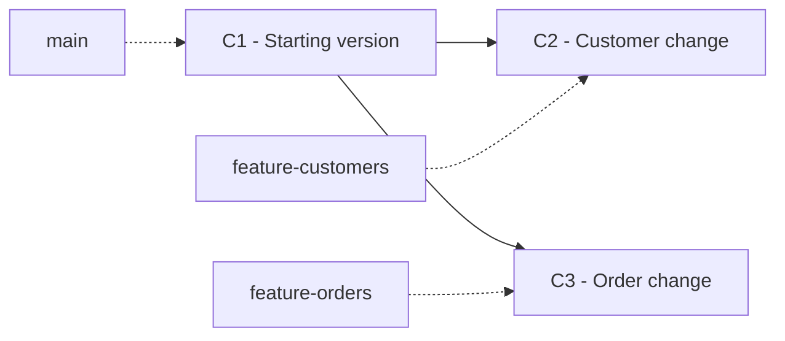
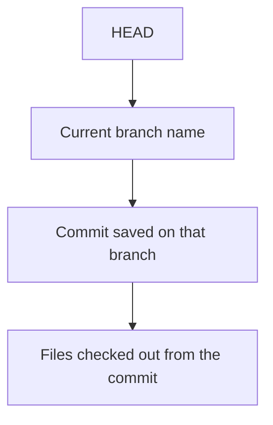

# Git Session 4 — Branching Fundamentals

**Tools:** Git Bash and Notepad  
**Practice:** Local Git repository only. GitHub is not needed.

## 1. What is a branch?

A **branch** is a name that points to a commit. When you make a new commit while working on that branch, the branch name moves forward to the new commit.

- `main` can hold the stable version of a project.
- `feature-customers` can hold customer-related changes.
- `feature-orders` can hold order-related changes.
- **HEAD** normally points to the branch you are currently using. That branch points to a commit.

A branch is **not a separate folder**. Git updates the files in the same working directory when you switch branches, provided it can do so safely.



In this diagram, both feature branches started from the same commit. Their later commits are independent. **Nothing has been merged.**

---

## 2. Start a small local practice repository

Create a separate practice folder so the earlier reset and reflog exercises do not affect these results.

| Git Bash command | What it does |
|---|---|
| `mkdir git-branching-practice` | Creates a new folder for the practice files. |
| `cd git-branching-practice` | Opens that folder in Git Bash. |
| `git init -b main` | Starts a local Git repository. `-b main` names its first branch `main`. |

Create these two files using **Notepad** and save them inside `git-branching-practice`.

**customers.txt**

```text
C101,Anaya,Active
C102,Rahul,Active
```

**orders.txt**

```text
O101,C101,1500
O102,C102,2200
```

| Git Bash command | What it does |
|---|---|
| `git status` | Checks which files are new or changed. |
| `git add customers.txt orders.txt` | Places the current content of both files in the staging area. |
| `git commit -m "C1 - Save starting files"` | Saves the staged files as the first commit. `-m` supplies the commit message directly. |
| `git branch` | Lists local branches. The `*` marks the current branch. |
| `git log --oneline --decorate` | Shows the commits in a short format. `--decorate` adds labels such as `HEAD` and `main`. |

**Check:** You should be on `main`, and both files should contain their starting data. If Git asks for your name or email, use the Git identity already configured during the earlier sessions.

---

## 3. Create a customer branch without changing main

Imagine you need to add a new customer, but you do not want to change the stable `main` version yet.

| Git Bash command | What it does |
|---|---|
| `git switch -c feature-customers` | Creates the `feature-customers` branch **and switches to it**. `-c` means *create*. |
| `git branch` | Confirms that `feature-customers` is now marked with `*`. |

Open `customers.txt` in Notepad, add this line, and save:

```text
C103,Meera,Active
```

| Git Bash command | What it does |
|---|---|
| `git status` | Shows that `customers.txt` has changed. |
| `git add customers.txt` | Selects the customer change for the next commit. |
| `git commit -m "C2 - Add Meera"` | Saves the customer change on `feature-customers`. |
| `git log --oneline --decorate -2` | Shows the latest two commits. `-2` limits the output to two commits. |

Now inspect the separation:

| Git Bash command | What it does |
|---|---|
| `git switch main` | Returns to the existing `main` branch. No new branch is created. |
| `git status` | Confirms that the working tree is clean. |
| `git switch feature-customers` | Returns to the customer branch. |

**Open `customers.txt` after each switch.** On `main`, Meera is absent. On `feature-customers`, Meera is present.

**Why?** Each branch points to a different commit. Switching branches selects the files saved in that branch's current commit. It does not delete the other branch's commits.

---

## 4. Create a second independent branch

Now make an order-related change starting from `main`, **not** from the customer branch.

| Git Bash command | What it does |
|---|---|
| `git switch main` | Moves back to the stable starting branch. |
| `git branch feature-orders` | Creates a branch named `feature-orders`, **but does not switch to it**. |
| `git branch` | Shows both feature branches; `*` is still beside `main`. |
| `git switch feature-orders` | Switches to the already-created order branch. |

Open `orders.txt` in Notepad, add the following line, and save:

```text
O103,C102,3000
```

| Git Bash command | What it does |
|---|---|
| `git add orders.txt` | Stages the new order. |
| `git commit -m "C3 - Add order O103"` | Saves this change on `feature-orders`. |
| `git switch main` | Returns to `main`. |

**Check these files by switching branches:**

| Branch | `customers.txt` | `orders.txt` |
|---|---|---|
| `main` | Two original customers | Two original orders |
| `feature-customers` | Three customers, including Meera | Two original orders |
| `feature-orders` | Two original customers | Three orders, including O103 |

The new customer does not automatically appear on the order branch, and the new order does not automatically appear on the customer branch.

---

## 5. See HEAD and compare branches

Make sure you are on `main` before running these commands.

| Git Bash command | What it does |
|---|---|
| `git branch` | Shows which branch is current. |
| `git log --oneline --graph --all --decorate` | Shows commits from all local branches in a visual graph. `--oneline` shortens each commit, `--graph` draws connections, `--all` includes all branch references, and `--decorate` shows names and HEAD. |
| `git diff main..feature-customers` | Compares the **file contents** at the tips of these branches. Here, it shows Meera added on the customer branch. |
| `git diff main..feature-orders` | Compares the two branch-tip snapshots. Here, it shows the extra order on the order branch. |

**Important:** `git diff main..feature-customers` does not switch branches or merge anything. It only displays differences. The `..` joins two names for this comparison.

### How HEAD behaves when branches move



When you switch to `feature-customers`, HEAD points to `feature-customers`. When you make another commit there, the branch name moves to the new commit. **HEAD continues to point to that branch name.**

---

## 6. Switch branches with unfinished changes

Sometimes you change a file but have not committed it. What happens when you switch branches?

### Case A — Git allows the switch

Start on `main`:

```bash
git switch main
```

Open `orders.txt`, add the line below, and save it **without using `git add` or `git commit`**:

```text
O999,C102,9000
```

| Git Bash command | What it does |
|---|---|
| `git status` | Shows an unfinished change in `orders.txt`. |
| `git switch feature-customers` | Switches successfully here because the committed `orders.txt` is the same on both branches. The unfinished edit stays in your working tree. |
| `git status` | Shows that `orders.txt` is **still modified**. The edit did not belong to either branch's commit. |
| `git switch main` | Returns to `main`, carrying the same unfinished edit. |
| `git restore -- orders.txt` | Discards the unstaged edit and restores the staged file content. `--` separates the command from the file name. |

**Check:** `O999` disappears after the final restore. An unfinished working-tree change is not automatically stored in a branch just because you switched branches.

### Case B — Git blocks the switch

Stay on `main`. Open `customers.txt`, add this line, and save **without committing**:

```text
C999,Temporary,Invalid
```

| Git Bash command | What it does |
|---|---|
| `git status` | Shows that `customers.txt` contains an unfinished edit. |
| `git switch feature-customers` | Git **refuses to switch**, because that branch has a different saved `customers.txt`, and switching would risk overwriting your unfinished edit. |
| `git diff -- customers.txt` | Shows the unstaged edit, so you can check what would be lost. |
| `git restore -- customers.txt` | Discards this unwanted practice edit from the working tree. |
| `git switch feature-customers` | Now switches successfully because the working tree is clean. |

**Check:** A failed branch switch does not mean your file was deleted. Git is protecting your unfinished work.

> `git restore` can permanently discard unstaged file edits. Use it here only because the added `C999` line is intentionally unwanted.

---

## 7. Branch HEAD versus detached HEAD

You have already used `git checkout` with an older commit hash. Now compare that behavior with switching branches.

You should currently be on `feature-customers`.

| Git Bash command | What it does |
|---|---|
| `git log --oneline -2` | Shows the customer commit and its parent. |
| `git checkout HEAD~1` | Checks out the **parent commit** of the current commit. HEAD now points directly to that old commit, instead of to a branch name. This is called *detached HEAD*. |
| `git status` | Shows that HEAD is detached. |
| `git branch` | Shows you are not currently attached to `feature-customers` or `main`. |
| `git switch feature-customers` | Returns to the customer branch and its latest saved files. |
| `git switch main` | Finishes on the stable `main` branch. |

| Operation | What HEAD points to | What happens to the branch name? |
|---|---|---|
| `git switch feature-customers` | The branch `feature-customers` | Branch keeps pointing to its latest commit |
| `git checkout HEAD~1` | An older commit directly | The branch does **not** move backward |

Checking out an older commit is useful for viewing historical files. To make and keep new commits as part of normal development, work on a branch instead of remaining in detached HEAD.

---

## 8. Commands that are easy to confuse

| Command | Simple difference |
|---|---|
| `git branch feature-orders` | **Create** a branch; stay where you are. |
| `git switch -c feature-orders` | **Create and enter** a new branch. Fails if it already exists. |
| `git switch feature-orders` | Enter a branch that **already exists**. |
| `git checkout <commit-hash>` | Visit a particular old commit; usually results in detached HEAD. |
| `git log --oneline --graph --all --decorate` | **See** where the commits and branch names are; changes nothing. |
| `git diff main..feature-customers` | **Compare** the files saved by two branch tips; changes nothing. |
| `git restore -- customers.txt` | Discard unstaged changes to that file and return it to its staged content; does not switch branches. |

**No merge has happened in this lesson.** The feature branches still have separate commits. Merging and merge conflicts are separate topics.

---

## 9. Check your understanding

1. You create `feature-customers`, but `git branch` still shows `* main`. Which command did you probably use?
2. You commit a new customer on `feature-customers`. Why does `main` still show the older customer list?
3. If you run `git switch main`, does Git delete the customer-branch commit?
4. If you change `orders.txt` without committing, can the edit appear when you switch branches?
5. Why might Git refuse a branch switch when you have unfinished edits?
6. How is `git checkout <commit-hash>` different from `git switch feature-customers`?
7. Which command shows the locations of `main`, `feature-customers`, `feature-orders`, and HEAD on one commit graph?

**Final check:** Run `git status` and `git branch`. You should have a clean working tree on `main`, with two separate feature branches available for the next lesson.
