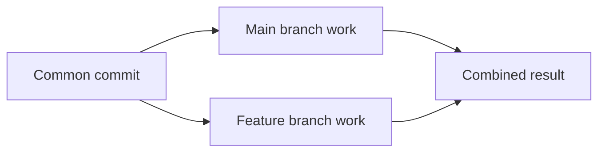
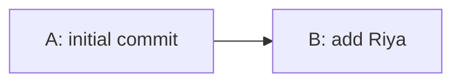
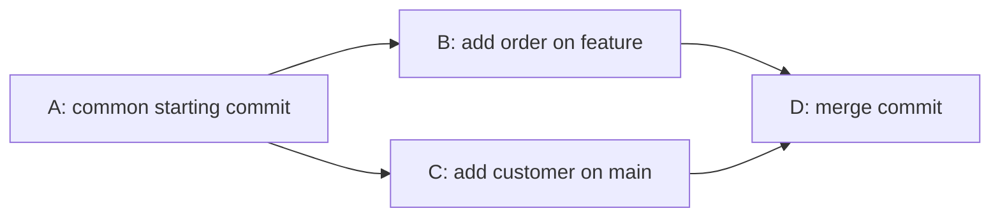

# Git Session 5 — Merging and Conflict Resolution

**Tools:** Git Bash and Notepad  
**Practice:** Local Git repository only. GitHub is not required.

**Goal:** Combine changes from two branches, understand why some merges are automatic, resolve a conflict, and cancel a merge when needed.

> **Use a new practice folder.** The exercises build on each other. Finish them in order, and start each exercise with a clean working tree (`git status`). Do not run these commands in an important project.

---

## 1. What does merging mean?

A branch lets you work separately. **Merging** brings the work from one branch into another.

For example, if you are on `main` and run:

```bash
git merge feature/customers
```

Git brings the commits from `feature/customers` into **the current branch (`main`)**. The feature branch does not disappear. Merging does **not** mean switching to the feature branch.

| Term | Simple meaning |
|---|---|
| **Current branch** | The branch you are working on. `HEAD` normally points to it. |
| **Source branch** | The branch whose changes you want to bring in. |
| **Fast-forward** | Git moves the current branch pointer forward because the current branch has no new commits of its own. |
| **Merge commit** | A new commit that joins two histories. It normally has two parents. |
| **Conflict** | Git cannot safely choose between competing edits. A person must decide the final content. |



**A merge conflict is not guaranteed.** Two branches can have different commits and still merge automatically, especially when they change different files.

---

## 2. Create a small practice repository

Open **Git Bash** in a location where you can create a new folder.

| Run in Git Bash | What it does |
|---|---|
| `mkdir git-session-05` | Creates a new practice folder. |
| `cd git-session-05` | Moves Git Bash into that folder. |
| `git init -b main` | Starts a local Git repository with a branch named `main`. `-b` chooses the starting branch name. |
| `notepad customers.txt` | Opens the customer file in Notepad. If it does not exist, create and save it. |

Save **`customers.txt`** with exactly these lines:

```text
C101,Anaya,Active
C102,Rahul,Active
C103,Meera,Active
```

Open another file with `notepad orders.txt` and save **`orders.txt`**:

```text
O101,C101,1500
O102,C102,2200
```

| Run in Git Bash | What it does |
|---|---|
| `git status` | Shows the files Git has not started tracking yet. |
| `git add customers.txt orders.txt` | Selects both files for the next commit. |
| `git commit -m "Initial customer and order records"` | Saves the selected files as the first commit. `-m` lets you write the commit message directly. |
| `git status` | Confirms the working tree is clean. |

If a commit reports that your name or email is missing, configure them for this practice repository with `git config user.name "Git Student"` and `git config user.email "student@example.com"`, then repeat the commit. These settings are local to this repository (they do not use `--global`).

---

## 3. Scenario A — Fast-forward merge

**Situation:** A new customer is added on a feature branch. Nobody makes a new commit on `main` in the meantime.

### Create the feature work

| Run in Git Bash | What it does |
|---|---|
| `git switch -c feature/new-customer` | Creates `feature/new-customer` and switches to it. `-c` means *create*. |
| `notepad customers.txt` | Opens the customer file for editing. |

Add one line at the end and save:

```text
C104,Riya,Active
```

| Run in Git Bash | What it does |
|---|---|
| `git add customers.txt` | Selects the updated file for the next commit. |
| `git commit -m "Add customer Riya"` | Saves this change on the feature branch. |
| `git log --oneline --graph --all --decorate` | Displays short commits (`--oneline`), connecting lines (`--graph`), commits reachable through all references (`--all`), and labels such as branch names and HEAD (`--decorate`). |
| `git switch main` | Returns to `main`. Open `customers.txt`: Riya is not present there yet. |

### Merge into main

```bash
git merge feature/new-customer
```

`git merge` brings the named branch into the branch you are **currently on** (`main`).

**Expected:** Git reports **Fast-forward**. `customers.txt` on `main` now contains Riya, and Git did not create an extra merge commit.



Before the merge, `main` pointed to A and `feature/new-customer` pointed to B. After the merge, **both point to B**.

Verify with `git log --oneline --graph --all --decorate` and `git status`.

---

## 4. Scenario B — Both branches changed, but no conflict

**Situation:** One developer adds an order on a feature branch. Meanwhile, someone adds a customer on `main`. The changes are in different files.

### Make a change on the feature branch

```bash
git switch -c feature/new-order
```

This creates a new branch from the current `main` commit and switches to it.

Open `orders.txt` in Notepad. Add this line and save:

```text
O103,C103,1800
```

| Run in Git Bash | What it does |
|---|---|
| `git add orders.txt` | Selects the new order for the next commit. |
| `git commit -m "Add order O103"` | Saves the order change on `feature/new-order`. |
| `git switch main` | Returns to `main`. The new order is not present on this branch yet. |

### Make a separate change on main

Open `customers.txt` and add this line:

```text
C105,Kiran,Active
```

Then run:

```bash
git add customers.txt
git commit -m "Add customer Kiran"
```

The first command stages the customer file; the second saves it on `main`. Now the branches have different new commits.

### Combine both histories

```bash
git merge --no-edit feature/new-order
```

- `git merge feature/new-order` brings that branch's changes into the **current** branch (`main`).
- `--no-edit` accepts Git's default merge-commit message without opening a text editor. It does **not** mean “do not edit files.”

**Expected:** The merge succeeds automatically and creates a **merge commit**, because both branches had progressed separately. `customers.txt` contains Kiran, and `orders.txt` contains O103.



Verify:

```bash
git log --oneline --graph --all --decorate
```

This shows the separate lines of development joining at a merge commit.

**Compare with Scenario A:** In a fast-forward merge, `main` simply moved forward. Here, Git had to join **two lines of history**. A merge commit does **not** mean there was a conflict.

---

## 5. Scenario C — Two branches change the same customer

**Situation:** Two developers independently change the status of the same customer. Git must ask which value should be kept.

### Change the customer on the feature branch

```bash
git switch -c feature/customer-status
```

Open `customers.txt`. Change only this line:

```text
C102,Rahul,Active
```

To:

```text
C102,Rahul,Gold
```

Save and run:

```bash
git add customers.txt
git commit -m "Mark Rahul as Gold"
git switch main
```

The first two commands save the change on the feature branch. The last command goes back to `main`, where Rahul is still `Active`.

### Change the same line differently on main

Open `customers.txt` on `main`. Change:

```text
C102,Rahul,Active
```

To:

```text
C102,Rahul,Inactive
```

Save and run:

```bash
git add customers.txt
git commit -m "Mark Rahul as Inactive"
```

### Try to merge

```bash
git merge feature/customer-status
```

**Expected:** Git reports a **CONFLICT** and says the automatic merge failed. This is the expected result, not a problem with your setup.

```bash
git status
```

`git status` shows that `customers.txt` has changes Git could not combine.

Open `customers.txt`. Near Rahul's record, you should see something like:

```text
<<<<<<< HEAD
C102,Rahul,Inactive
=======
C102,Rahul,Gold
>>>>>>> feature/customer-status
```

| Marker | Meaning |
|---|---|
| `<<<<<<< HEAD` | Beginning of the current branch's version (`main`). |
| `=======` | Separator between the two versions. |
| `>>>>>>> feature/customer-status` | End of the incoming feature branch's version. |

`HEAD` is **your current branch**, not automatically the “correct” version.

### Resolve the conflict in Notepad

Keep **one final line** for Rahul. For this exercise, choose:

```text
C102,Rahul,Gold
```

Remove the `<<<<<<<`, `=======`, and `>>>>>>>` marker lines. Save the file. Do not delete the other customer records.

| Run in Git Bash | What it does |
|---|---|
| `git diff --check` | Checks for some common whitespace problems and remaining conflict markers in changed lines. Also inspect the file in Notepad. |
| `git add customers.txt` | Tells Git you have finished editing the conflicted file and selects its final content. |
| `git status` | Shows that all conflicts are fixed, but the merge still needs a commit. |
| `git commit -m "Merge customer status changes"` | Finishes the merge by creating a merge commit with your resolved customer record. `-m` supplies the commit message directly. |
| `git log --oneline --graph --all --decorate` | Shows both histories joining at the new merge commit. |

**Expected:** `customers.txt` contains `C102,Rahul,Gold`. `git status` reports a clean working tree. The earlier `Inactive` commit still exists in history, but the new merge commit records the chosen result.

> You may also see `git merge --continue` in other lessons. It finishes a paused merge **after** conflicts have been resolved and staged, usually opening an editor for the merge message. Here, `git commit -m ...` completes the same merge while specifying the message directly.

---

## 6. Scenario D — A conflict occurs, but you cancel the merge

**Situation:** Two branches change another customer's status. You decide not to combine these changes yet.

### Make the feature-branch change

```bash
git switch -c feature/customer-contact
```

In `customers.txt`, change:

```text
C101,Anaya,Active
```

To:

```text
C101,Anaya,EmailPending
```

Save and run:

```bash
git add customers.txt
git commit -m "Mark Anaya email as pending"
git switch main
```

### Make a different change on main

In `customers.txt`, change:

```text
C101,Anaya,Active
```

To:

```text
C101,Anaya,EmailVerified
```

Save and run:

```bash
git add customers.txt
git commit -m "Mark Anaya email as verified"
```

Now attempt the merge:

```bash
git merge feature/customer-contact
```

**Expected:** Another conflict in `customers.txt`.

```bash
git status
git merge --abort
```

- `git status` confirms a merge is waiting for conflict resolution.
- `git merge --abort` stops the unfinished merge and **tries to return your files and staging area to how they were before the merge started**. It does not delete either branch's existing commits.

**Check:** On `main`, `customers.txt` still contains `C101,Anaya,EmailVerified`. The feature branch still has `C101,Anaya,EmailPending`.

```bash
git status
git log --oneline --graph --all --decorate
```

**Difference:** `git merge --abort` cancels a merge that is still in progress. `git revert` creates a new commit to reverse a change that has already been committed. They are not interchangeable.

> Start a merge with a clean working tree whenever possible. If you had unfinished edits before a merge, aborting may not always restore every pre-merge change correctly.

---

## 7. Extra practice — Make a merge commit even when fast-forward is possible

Normally, Git does a fast-forward when it can. Sometimes a team wants an explicit merge commit so the feature work has a visible joining point.

Create a branch from `main`:

```bash
git switch -c feature/release-notes
```

Create `release-notes.txt` in Notepad with this text:

```text
Customer updates reviewed
```

Save and run:

```bash
git add release-notes.txt
git commit -m "Add release notes"
git switch main
```

Merge with:

```bash
git merge --no-ff --no-edit feature/release-notes
```

- `--no-ff` means **no fast-forward**. Git creates a merge commit even though it could have moved the branch pointer forward without one.
- `--no-edit` accepts the suggested merge-commit message without opening an editor.

Run `git log --oneline --graph --all --decorate` to see the separate merge commit.

| Merge command | What happens when fast-forward is possible? |
|---|---|
| `git merge feature/release-notes` | Usually moves `main` forward without a new merge commit. |
| `git merge --no-ff feature/release-notes` | Creates a merge commit instead. |
| `git merge --ff-only feature/release-notes` | Allows only a fast-forward; stops if the histories have diverged. |

`--ff-only` means *fast-forward only*. It is included for comparison; you do not need to run it here.

---

## 8. Remove branch names after successful merging

Merging **does not automatically delete** the source branch. The branch names can be removed after their changes are safely included in `main`.

Make sure you are on `main`:

```bash
git branch
git switch main
```

`git branch` lists local branches; `*` marks the current branch. `git switch main` selects `main` if you are on another branch.

Now run:

```bash
git branch -d feature/new-customer
git branch -d feature/new-order
git branch -d feature/customer-status
git branch -d feature/release-notes
```

`-d` means **delete the branch name safely**. Git checks whether the branch is merged before deleting it. Deleting a merged branch name does **not** delete the changes that are already part of `main`.

**Do not delete `feature/customer-contact` yet.** Its change was not merged because the merge was aborted. A safe `git branch -d feature/customer-contact` should refuse to delete it while those commits remain unmerged. This protects unfinished work.

---

## 9. Which command should I use?

| Situation | Command | What changes? |
|---|---|---|
| Bring a feature into the current branch | `git merge feature/name` | Combines histories, sometimes by fast-forward. |
| Preserve an explicit merge commit | `git merge --no-ff feature/name` | Prevents fast-forward. |
| Avoid a merge-message editor | `git merge --no-edit feature/name` | Uses the default message if a merge commit is created. |
| Fix a conflict | Edit in Notepad, then `git add file` and `git commit -m "..."` | Saves your chosen final content in a merge commit. |
| Stop a merge before finishing it | `git merge --abort` | Attempts to return to the pre-merge state. |
| Remove a branch after its work was merged | `git branch -d feature/name` | Deletes its branch reference, not the merged work. |

### Remember

1. **Switching** changes which branch you are on. **Merging** brings another branch's work into the current one.
2. A **fast-forward merge** needs no extra merge commit. A **diverged history** normally needs a merge commit.
3. A **merge commit** does not automatically mean there was a conflict.
4. A **conflict** means you must decide and save the correct final file content.
5. **Abort** works while a merge is still in progress; it is not the same as reverting a completed merge.

---

## Final check

```bash
git status
git branch
git log --oneline --graph --all --decorate
```

These commands show whether your working tree is clean, which local branches remain, and how the commits are connected. `feature/customer-contact` remains separate because its merge was cancelled.
