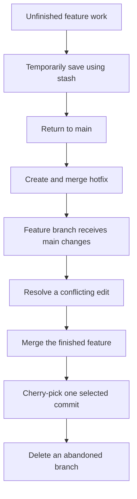

# Git Session 6 — Real-World Branching Scenarios

**Tools:** Git Bash  
**Practice files:** `customers.txt`, `orders.txt`, and a few small text files  
**All work is local.** No GitHub or programming is needed.

You will use **one repository** for all five scenarios. Each scenario finishes with a clean working tree. You can see the complete history as the exercises progress.

## Before you begin

Open Git Bash in a folder where you want to keep the practice project. Run this block **once**:

```bash
mkdir git-session-06
cd git-session-06
git init -b main

git config user.name "Git Student"
git config user.email "student@example.com"

printf '%s\n' 'C101,Anaya,Active' 'C102,Rahul,Active' > customers.txt
printf '%s\n' 'O101,C101,1500' 'O102,C102,2200' > orders.txt

git add customers.txt orders.txt
git commit -m "Initial customer and order data"
git status
```

`git init -b main` creates a repository with its first branch named `main`. The `-b` option specifies that branch name. The two `git config` commands set a name and email **only for this practice repository**, so Git can identify the author of its commits. `git add` selects the files; `git commit -m` saves them, using the message written after `-m`.

### Writing text files from Git Bash

| Command pattern | What it does |
|---|---|
| `printf '%s\n' 'some text' > file.txt` | **Replaces** the file with the given text (or creates it). `>` means write from the beginning. |
| `printf '%s\n' 'some text' >> file.txt` | **Adds** a line at the end of the file. `>>` means append. |
| `cat file.txt` | Displays the current file contents without changing the file. |
| `git status` | Shows which files have uncommitted changes. |

`printf` writes each quoted piece of text as a line. `%s\n` means print the text followed by a new line. These are **Git Bash file commands**, not Git history commands.

---

## Scenario 1 — Urgent work arrives before your feature is finished

**Situation:** You are adding customer information on a feature branch. You have changed a tracked file and created a new text file, but neither is ready to commit. You need to switch to `main` temporarily.

### Start the customer feature

```bash
git switch -c feature-customer-contact
printf '%s\n' 'C103,Meera,Active' >> customers.txt
printf '%s\n' 'Call Meera to confirm contact details' > followup.txt
git status --short
```

`git switch -c` creates a branch and switches to it; `-c` means **create**. `>>` appends Meera without removing the existing customers. `followup.txt` is a **new, untracked** file. `git status --short` shows a compact status: ` M` for a modified tracked file and `??` for an untracked file.

### Save unfinished work temporarily

```bash
git stash push -u -m "Unfinished customer follow-up"
git stash list
git status

git switch main
cat customers.txt
```

`git stash push` temporarily stores working changes and cleans them from your working tree. `-u` means **include untracked files**, such as `followup.txt`; without `-u`, normal stash does not save that new file. `-m` attaches a readable message to the stash. `git stash list` displays saved stashes. On `main`, you see the original customers; the unfinished addition is not committed there.

### Resume and finish the feature

```bash
git switch feature-customer-contact
git stash pop
cat customers.txt
cat followup.txt
git status

git add customers.txt followup.txt
git commit -m "Add customer follow-up"
git switch main
git status
```

`git stash pop` brings the latest saved changes back to the working tree and, **if successfully applied**, removes that stash entry. You then commit the completed feature on its branch. Switching back to `main` does not merge the feature into `main`.

**Check:** The stash is no longer needed, `main` is clean, and the customer feature still has its own commit. `git branch` shows both branches.

---

## Scenario 2 — Fix an urgent problem in the stable branch

**Situation:** Order O102 has an incorrect amount (`2200`). The stable `main` branch needs a correction, without bringing in the unfinished customer feature.

### Create and complete a hotfix

```bash
git switch -c hotfix-order-total
printf '%s\n' 'O101,C101,1500' 'O102,C102,2000' > orders.txt
git diff -- orders.txt

git add orders.txt
git commit -m "Correct order O102 amount"

git switch main
git merge hotfix-order-total
cat orders.txt
git log --oneline -4
```

A **hotfix** is a small, urgent correction. Here, `>` replaces the file with the corrected two rows. `git diff -- orders.txt` shows what changed before committing; `--` separates the command from the file name. `git merge hotfix-order-total` brings the fix into the branch you are currently on (`main`). This merge should be **fast-forward**: only the hotfix branch advanced, so Git moves `main` to its newer commit without creating another merge commit.

### Remove the completed hotfix branch

```bash
git branch -d hotfix-order-total
git status
```

`git branch -d` deletes the branch **name** after Git confirms it is safely merged. `-d` requests a safe deletion. The committed fix stays in `main`.

**Check:** On `main`, O102 now has amount `2000`. The customer feature branch still exists separately.

---

## Scenario 3 — Main changes while your feature is in progress

**Situation:** You start reviewing Anaya's status on a feature branch. Another change is committed on `main` before your feature is finished. Both changes affect the **same line**, so Git needs your decision.

### Make a change on the feature branch

```bash
git switch -c feature-customer-review
printf '%s\n' 'C101,Anaya,Verified' 'C102,Rahul,Active' > customers.txt
git add customers.txt
git commit -m "Mark Anaya as verified on feature"
```

`feature-customer-review` now has one new commit. `main` has not received that commit.

### Another change arrives on main

```bash
git switch main
printf '%s\n' 'C101,Anaya,Pending' 'C102,Rahul,Active' > customers.txt
git add customers.txt
git commit -m "Mark Anaya as pending on main"

git switch feature-customer-review
git merge main
```

The last command tries to bring the latest **`main` changes into the feature branch**. This is the reverse direction from merging a feature *into* `main`. Git should stop with a **merge conflict**, because both branches changed Anaya's status differently.

### Inspect and resolve the conflict

```bash
git status
cat customers.txt
```

You will see conflict markers similar to these:

```text
<<<<<<< HEAD
C101,Anaya,Verified
=======
C101,Anaya,Pending
>>>>>>> main
C102,Rahul,Active
```

`HEAD` here is the branch you are on (`feature-customer-review`); `main` is the incoming branch. The markers are **not valid customer records**. Choose a final value and remove the markers. For practice, choose `Approved`:

```bash
printf '%s\n' 'C101,Anaya,Approved' 'C102,Rahul,Active' > customers.txt
git add customers.txt
git commit -m "Merge main into feature and resolve Anaya status"
git status
```

`git add` tells Git the conflict has been resolved using the file's current content. `git commit -m` completes the merge and supplies a message without opening a text editor.

### Bring the completed feature into main

```bash
git switch main
cat customers.txt
git merge feature-customer-review
cat customers.txt
git log --oneline --graph --all --decorate -9

git branch -d feature-customer-review
git status
```

Before the second merge, `main` still shows `Pending`. After the merge, `main` shows `Approved`. The feature branch had already incorporated `main`, so the last merge can **fast-forward** `main` to the feature's merge commit. `--oneline` shortens each commit, `--graph` draws the connections, `--all` includes branches, `--decorate` shows branch/HEAD labels, and `-9` limits the output to nine commits.

**Check:** No conflict remains, and `main` contains the agreed customer status.

---

## Scenario 4 — Bring only one commit from another branch

**Situation:** A developer has made three commits in a feature branch, but only the middle commit is ready for `main`. You do **not** want the other two commits yet.

### Make three separate commits on a feature branch

```bash
git switch -c feature-fulfillment

printf '%s\n' 'O103,C101,3500' >> orders.txt
git add orders.txt
git commit -m "Add order O103"

printf '%s\n' 'O102,Prepare shipment after address check' > shipping.txt
git add shipping.txt
git commit -m "Add shipping instruction"

printf '%s\n' 'Draft: festival coupon plan' > discounts.txt
git add discounts.txt
git commit -m "Draft discount plan"

git log --oneline -3
```

There are three distinct commits: **order**, **shipping**, and **discount**. We want only the shipping instruction.

### Copy the selected commit into main

```bash
git switch main
git cherry-pick feature-fulfillment~1
cat shipping.txt
cat orders.txt
git status
git log --oneline -3
```

`git cherry-pick` takes the **changes introduced by one selected commit** and saves them as a new commit on your current branch. `feature-fulfillment~1` means the parent of that branch's latest commit: in this exact example, the **middle** commit, *Add shipping instruction*. This avoids manually copying a commit hash.

The shipping file now exists on `main`, but order O103 and `discounts.txt` from the other commits have **not** been brought into `main`. The original three commits remain on `feature-fulfillment`. Cherry-picking normally gives the copied change a new commit ID.

**Compare:** `git merge feature-fulfillment` would integrate the entire feature branch history, not select just one of its commits.

---

## Scenario 5 — Abandon a branch without merging it

**Situation:** A report feature is cancelled. Its branch has a commit that you do not want in `main`.

### Create a feature and abandon it

```bash
git switch -c feature-old-report
printf '%s\n' 'Old report draft - not approved' > old-report.txt
git add old-report.txt
git commit -m "Draft old report"

git switch main
git branch -d feature-old-report
```

The last command should **refuse** to delete this branch because its commit has not been merged. This is a safety check, not an unexpected failure.

### Force-delete the abandoned branch

```bash
git branch -D feature-old-report
git branch
git log --oneline --all --decorate -6
```

`-D` means **force delete**. It removes the local branch name even when its commit is unmerged. It does not immediately erase the commit object, but the commit may no longer appear in ordinary branch history. Local reflog information may help recover it later; that recovery is not guaranteed forever.

**Check:** `feature-old-report` is absent from `git branch`. `old-report.txt` was never brought into `main`.

---

## How the workflows fit together



## Quick command reference

| Command | Simple meaning |
|---|---|
| `git stash push -u -m "message"` | Temporarily saves tracked edits and untracked files with a description. |
| `git stash list` | Shows saved unfinished work. |
| `git stash pop` | Restores the latest stash; removes it when applied successfully. |
| `git switch -c name` | Creates and switches to a new branch. |
| `git merge name` | Brings the named branch's changes/history into the current branch. |
| `git status` | Shows changed files and whether a merge needs attention. |
| `git add file` | Stages a file, including a manually resolved conflict. |
| `git cherry-pick commit` | Applies one commit's change to the current branch as a new commit. |
| `git branch -d name` | Safely deletes a merged branch. |
| `git branch -D name` | Force-deletes a local branch, including an unmerged one. |

**Before switching branches or beginning a new scenario, use `git status`.** A clean working tree makes each next step predictable. Commands such as `>` overwrite file contents, so use them only for these practice files.
