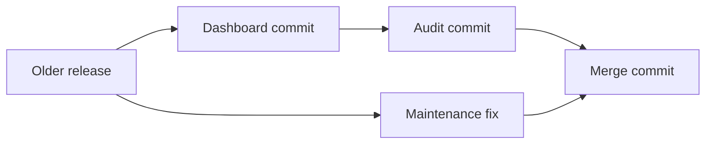

# Git Session 6 — Real-World Branching Scenarios

**Tools:** Git Bash  
**Files:** Simple `.txt` files created using commands  
**Environment:** One local Git repository; no GitHub required

This lesson follows six independent workplace situations inside **one practice repository**. Each scenario uses its own branch names and file changes, so the work is easy to identify. The commit history continues growing as you progress.

> **Before starting each scenario:** Make sure you are on `main` with `git status` showing a clean working tree, unless a step specifically tells you to switch elsewhere. Run the steps in the given order.

## First, create the practice repository

Run this block **once** in Git Bash, in a location where the `git-industry-practice` folder does not already exist:

```bash
mkdir git-industry-practice
cd git-industry-practice
git init -b main

git config user.name "Git Student"
git config user.email "student@example.com"

printf '%s\n' 'C101,Anaya,Active' 'C102,Rahul,Active' > customers.txt
printf '%s\n' 'O101,C101,1500' 'O102,C102,2200' > orders.txt

git add customers.txt orders.txt
git commit -m "Initial customer and order records"
git status
```

`git init -b main` creates a new repository with a branch named `main`. The `-b` option chooses its name. The `git config` commands set a practice author name and email **only in this repository**. Git uses these details when making commits; no GitHub account is needed.

### Small Git Bash commands used in the lesson

| Command | Meaning |
|---|---|
| `printf '%s\n' 'text' > file.txt` | Create or **replace** a file with the text. `>` overwrites its old content. |
| `printf '%s\n' 'text' >> file.txt` | Add text to the **end** of a file. `>>` does not remove existing lines. |
| `cat file.txt` | Display the file's contents. |
| `git status` | Check current branch and uncommitted changes. |
| `git log --oneline -3` | Show the latest three commits in a shorter format. `-3` is the maximum number displayed. |

`printf` writes the quoted values as separate lines; `%s\n` means **print text followed by a new line**. It is a Git Bash command, not a Git version-control command.

---

## Scenario 1 — Save unfinished work and return to it later

**Situation:** You are working on customer contact details, but an urgent task arrives. You cannot finish or commit the current work yet. You need to put it aside without losing it.

### Step 1. Start a feature and make unfinished changes

```bash
git switch -c feature/customer-contact
printf '%s\n' 'C103,Meera,Active' >> customers.txt
printf '%s\n' 'Check Meera phone number' > contact-notes.txt
git status --short
```

`git switch -c` **creates and switches** to a branch (`-c` means *create*). `customers.txt` is an already tracked file that is now modified. `contact-notes.txt` is new and **untracked**: Git has not been told to track it. `--short` gives a compact status (` M` means modified; `??` means untracked).

### Step 2. Put both unfinished changes aside

```bash
git stash push -u -m "Unfinished customer contact work"
git stash list
git status
```

`git stash push` saves unfinished changes in a temporary Git storage area and cleans them from the working tree. `-u` means **include untracked files** (such as `contact-notes.txt`); ordinary stash does not include them. `-m` supplies a description. `git stash list` shows saved stashes.

**Check:** The working tree is clean and the new contact-notes file is no longer present in the folder.

### Step 3. Switch away without carrying unfinished work

```bash
git switch main
cat customers.txt
git status
```

You can switch because the unfinished edits were put into the stash. `main` still has the original two customers; the unfinished feature is not committed to `main`.

### Step 4. Return to the feature and recover the work

```bash
git switch feature/customer-contact
git stash pop
cat customers.txt
cat contact-notes.txt
git stash list
```

`git stash pop` brings back the **latest** stash and removes its saved entry **if applying it succeeds**. The customer and contact-note edits are now back in the working tree.

### Step 5. Finish the feature, but keep it separate from main

```bash
git add customers.txt contact-notes.txt
git commit -m "Add customer contact follow-up"
git switch main
git status
```

The completed work is committed **on the feature branch**, not on `main`. Switching to `main` does not automatically merge the work.

**Stash distinctions:** `git stash apply` also restores a stash, but **keeps** its saved copy. `git stash pop` restores it and normally **removes** that copy. Do not run `apply` and then `pop` on the same unchanged files: the edits are already present, and applying them again may fail. You can have several stashes in one repository; they are **not limited to one per branch**. `git stash pop 'stash@{1}'` selects a particular saved stash rather than the newest one. Stashes do not expire after a fixed number of minutes; use `git stash drop 'stash@{0}'` to delete one or `git stash clear` to delete all when they are no longer needed.

---

## Scenario 2 — Fix an urgent production issue safely

**Situation:** The stable project has order O102 recorded as `2200`, but the correct amount is `2000`. You want to fix it without including unfinished feature work in `main`.

### Step 1. Start a hotfix branch from main

```bash
git switch main
git status
git switch -c hotfix/order-amount
```

A **hotfix** is a small, urgent correction. By starting from `main`, the branch contains the stable version, not the unmerged customer-contact feature.

### Step 2. Correct the order and inspect the change

```bash
printf '%s\n' 'O101,C101,1500' 'O102,C102,2000' > orders.txt
git diff -- orders.txt
cat orders.txt
```

The `>` symbol replaces the small practice file with the corrected records. `git diff -- orders.txt` shows the change in the working tree compared with staging. `--` separates Git's options from the file name.

### Step 3. Commit the fix on the hotfix branch

```bash
git add orders.txt
git commit -m "Correct amount for order O102"
git log --oneline -2
```

The correction is saved on `hotfix/order-amount`. `main` has not been modified yet.

### Step 4. Merge the hotfix into main

```bash
git switch main
git merge hotfix/order-amount
cat orders.txt
git log --oneline -3
```

Since `main` made **no new commits** after the hotfix branch was created, this is a **fast-forward merge**: Git moves the `main` pointer forward to the hotfix commit. No extra merge commit is needed.

**Why no conflict despite `2200` becoming `2000`?** The two branches were not independently changing the same record. Only the hotfix branch changed that amount after their common starting commit. A conflict becomes possible when both branches make incompatible edits to the same part of a file.

### Step 5. Remove the completed hotfix branch

```bash
git branch -d hotfix/order-amount
git status
```

`-d` requests **safe branch deletion**. The branch name disappears, but the fix remains in `main` because it was merged.

**Industry connection:** A fix can be committed directly to `main` in Git, but a separate hotfix branch allows review and testing before the correction is accepted. Teams commonly restrict direct changes to protected main branches.

---

## Scenario 3 — A commit was made on the wrong branch

**Situation:** You were supposed to add a customer report on a feature branch, but you accidentally committed it to `main`. The commit is **local and has not been pushed or shared**.

### Step 1. Make the accidental commit on main

```bash
git switch main
printf '%s\n' 'Customer report draft' > customer-report.txt
git add customer-report.txt
git commit -m "Add customer report draft on wrong branch"
git log --oneline -2
```

The report is now part of `main` history, even though it belongs on its own feature branch.

### Step 2. Preserve the commit on a new feature branch

```bash
git switch -c feature/customer-report
git log --oneline -1
cat customer-report.txt
```

The new branch points to the **same existing commit**. You have not copied the file or made a second commit. This protects the report commit before moving `main` backward.

### Step 3. Remove the accidental commit from local main

```bash
git switch main
git status
git reset --hard HEAD~1
git log --oneline -2
```

`HEAD~1` means **the parent of the current commit**. `git reset` moves the current branch pointer there. `--hard` also makes the staging area and tracked working-tree files match that commit. **Only use this here because the working tree is clean and the bad commit has not been shared.**

### Step 4. Verify where the report is now

```bash
git status
git ls-files customer-report.txt
git switch feature/customer-report
cat customer-report.txt
git switch main
git log --oneline --graph --all --decorate -7
```

On `main`, `git ls-files customer-report.txt` shows no tracked report. On `feature/customer-report`, `cat` displays it. The graph shows the separate branch retaining the commit.

**Why not simply `git revert`?** `revert` creates a **new commit** to undo the bad one and leaves the original in `main` history. Reset changes where local `main` points. For a commit that has **already been pushed or shared**, do not rewrite shared history casually; a revert on `main` is generally safer.

---

## Scenario 4 — Bring one selected commit from another branch

**Situation:** A developer made three commits on a feature branch. Only the shipping instruction is needed on `main` right now. The other changes are not ready.

### Step 1. Make the first feature commit

```bash
git switch main
git switch -c feature/fulfillment
printf '%s\n' 'O103,C101,3500' >> orders.txt
git add orders.txt
git commit -m "Add order O103"
```

This commit adds an order, but it is not yet on `main`.

### Step 2. Make the second feature commit

```bash
printf '%s\n' 'O102,Confirm address before shipping' > shipping.txt
git add shipping.txt
git commit -m "Add shipping instruction"
```

This is the **only** change we want on `main` at first.

### Step 3. Make the third feature commit

```bash
printf '%s\n' 'Draft discount offer' > discounts.txt
git add discounts.txt
git commit -m "Draft discount offer"
git log --oneline -3
```

The feature branch now has three new commits: order → shipping → discount. Git displays the latest (discount) first.

### Step 4. Select just the middle commit

```bash
git switch main
git cherry-pick feature/fulfillment~1
git log --oneline -2
cat shipping.txt
```

`git cherry-pick` **applies the change introduced by one commit** and saves it as a new commit on the current branch. Here, `feature/fulfillment~1` means one first-parent step behind the feature branch's latest commit: the **shipping commit**.

| Reference | In this exact three-commit example |
|---|---|
| `feature/fulfillment~0` | Latest feature commit: discount |
| `feature/fulfillment~1` | Previous feature commit: shipping |
| `feature/fulfillment~2` | Two parent steps back: order |

These are **ancestry steps**, not stash positions or the order in which Git displays branches. The cherry-picked shipping commit has a new commit ID on `main`.

### Step 5. Confirm the other two feature changes are still separate

```bash
cat orders.txt
git ls-files discounts.txt
git log --oneline --graph --all --decorate -9
```

On `main`, `orders.txt` does not yet have O103 and `discounts.txt` is not tracked. `git ls-files discounts.txt` therefore prints nothing. The original three commits still exist on `feature/fulfillment`.

### Step 6. Later, merge the full feature branch

```bash
git merge feature/fulfillment
cat orders.txt
cat shipping.txt
cat discounts.txt
git log --oneline --graph --all --decorate -10
```

Now `main` receives the remaining feature work. In this example, Git can merge automatically: the shipping instruction is **not duplicated** in the file even though it was cherry-picked earlier. The original shipping commit and its cherry-picked copy can both appear in history because they are different commits. If either side later made incompatible changes, a merge conflict could still occur.

**Cherry-pick vs merge:** Cherry-pick takes **one selected commit's changes**. Merge combines the branches' development histories.

---

## Scenario 5 — Start a maintenance branch from an older commit

**Situation:** The team has already added newer features to `main`, but an older release needs a correction. You must start from the older version, make the fix, then bring it into the latest `main` without losing newer work.

### Step 1. Save an older release snapshot

```bash
git switch main
printf '%s\n' 'R1,TaxRate,10' > release-rules.txt
git add release-rules.txt
git commit -m "Record release 1 tax rule"
```

This commit represents an older release containing an incorrect tax rate of `10`.

### Step 2. Let main move ahead with two new commits

```bash
printf '%s\n' 'Dashboard outline for new release' > dashboard.txt
git add dashboard.txt
git commit -m "Add dashboard outline"

printf '%s\n' 'Audit checklist for new release' > audit.txt
git add audit.txt
git commit -m "Add audit checklist"
git log --oneline -3
```

`main` now has **two newer commits** after the release snapshot: dashboard and audit.

### Step 3. Start a branch at the older release commit

```bash
git switch -c maintenance/release-1 main~2
cat release-rules.txt
git ls-files dashboard.txt audit.txt
git log --oneline -2
```

`main~2` means **two parent steps before the latest main commit**. Because we just made two newer commits, this is the release-rule commit. `git switch -c` creates a branch **starting at that old commit** and checks it out. `main` stays at its newer commit.

**Check:** `release-rules.txt` exists on the maintenance branch; `dashboard.txt` and `audit.txt` are not tracked there yet. The empty `git ls-files` output is expected.

### Step 4. Fix the older release and commit it

```bash
printf '%s\n' 'R1,TaxRate,12' > release-rules.txt
git diff -- release-rules.txt
git add release-rules.txt
git commit -m "Correct release 1 tax rate"
```

The maintenance branch now has its own fix. It does not automatically contain the newer main commits.

### Step 5. Merge the older-release fix into the latest main

```bash
git switch main
git merge maintenance/release-1
cat release-rules.txt
cat dashboard.txt
cat audit.txt
```

Git compares **three snapshots**: the shared older release commit, the latest main commit, and the maintenance commit. It combines changes made on both sides. This example should merge automatically because the maintenance branch changes `release-rules.txt`, while main's newer commits add other files.

**Could this produce a conflict?** Yes. If the newer `main` commits and the maintenance commit had changed the same part of `release-rules.txt` differently, Git might require manual resolution. A conflict does **not** mean merging is impossible; it means the final content must be chosen before completing the merge.

### Step 6. View the combined history and clean up

```bash
git log --oneline --graph --all --decorate -11
git branch -d maintenance/release-1
git status
```

`main` now contains both the release fix and the dashboard/audit work. The completed maintenance branch name can be deleted safely using `-d`.



**Industry connection:** Companies sometimes maintain older software releases while development continues on the latest version. Bringing a fix from an older maintenance branch into newer development is often called **forward-porting**. Moving an existing newer fix into an older supported release is commonly called **backporting**.

---

## Scenario 6 — Delete a cancelled feature without merging it

**Situation:** Work on a new report was committed to a feature branch, but the business cancelled it. The commit must not become part of `main`.

### Step 1. Make an unmerged feature commit

```bash
git switch main
git switch -c feature/abandoned-report
printf '%s\n' 'Unapproved report draft' > abandoned-report.txt
git add abandoned-report.txt
git commit -m "Draft abandoned report"
```

The draft exists only on its feature branch.

### Step 2. Try safe branch deletion

```bash
git switch main
git branch -d feature/abandoned-report
```

**Expected result:** Git refuses. The branch contains work that is not merged into `main`, so `-d` protects you from deleting its branch name accidentally.

### Step 3. Delete the abandoned branch intentionally

```bash
git branch -D feature/abandoned-report
git branch
git status
```

`-D` means **force delete**, even when the commits are unmerged. It removes the local branch pointer, not necessarily the commit data immediately. The discarded commit may be recoverable temporarily through Git's reflog, but recovery is not guaranteed forever.

**Important difference:** `-d` is the safe option for completed, merged work; `-D` is used when you intentionally want to abandon an unmerged local branch.

---

## Quick decision guide

| Situation | Use | Why |
|---|---|---|
| Need to put unfinished work aside | `git stash push -u -m "message"` | Saves tracked and untracked edits temporarily. |
| Need to bring stash changes back and keep a saved copy | `git stash apply` | Reapplies changes without deleting the stash entry. |
| Need to bring stash changes back and remove its saved copy | `git stash pop` | Reapplies changes and removes stash if successful. |
| Need an urgent fix separate from other work | `git switch -c hotfix/name` | Allows the fix to be tested before merging. |
| Committed on the wrong branch locally | Create the correct branch, then reset `main` | Keeps the commit reachable from the correct branch. |
| Need only one commit from another branch | `git cherry-pick <commit>` | Copies that commit's change, not the whole branch history. |
| Need to work from an older version | `git switch -c name main~2` | Creates a branch at a selected ancestor of main. |
| Finished branch is merged | `git branch -d name` | Safely removes the branch name. |
| Cancelled branch is not merged | `git branch -D name` | Force-removes the branch name. |

### Final checks

```bash
git switch main
git status
git branch
git log --oneline --graph --all --decorate -15
```

A clean `git status` means there are no unfinished tracked-file changes or untracked files in the working tree. The graph may still show unmerged feature branches from earlier scenarios. Their presence is expected: **creating, switching to, or deleting another branch does not automatically merge unrelated feature work**.

> All commands in this lesson are intended for the disposable practice repository. `>` overwrites files, `git reset --hard` can discard local changes, and `git branch -D` can make unmerged commits harder to find. Always check the current branch and `git status` before using them in a real project.
