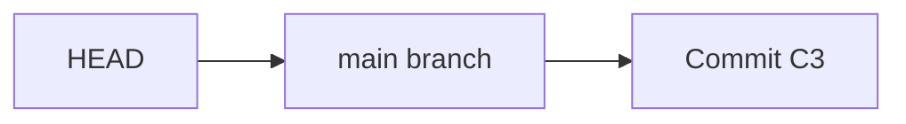
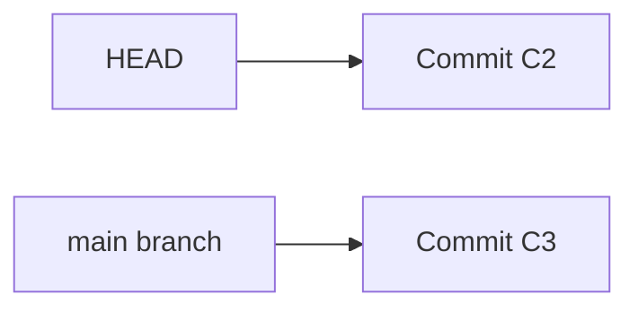

# Git Session 7 — HEAD, Detached HEAD, and Release Tags

**Tools:** Git Bash  
**Practice:** One local repository; all file changes are made using commands.

In this lesson, you will see where HEAD points after switching commits, resetting, reverting, merging, and creating a release tag. You will also recover a commit made while HEAD is detached.

---

## 1. Understand what HEAD actually points to

A **commit** is a saved version of the project. A **branch** (such as `main`) is a name pointing to a commit. **HEAD** tells Git which branch or commit is currently checked out.

| HEAD state | Meaning | Example inside `.git/HEAD` |
|---|---|---|
| **Attached** | HEAD points to a branch, which points to a commit. | `ref: refs/heads/main` |
| **Detached** | HEAD points directly to a commit, not through a branch. | A long commit hash |



*Attached HEAD: new commits normally move `main` forward.*



*Detached HEAD: Git has checked out C2 directly, but `main` still points to C3.*

### Step 1 — Create a small project

Use a new folder so commands from earlier lessons cannot affect these results. Git is already installed; there is no installation or GitHub setup here.

```bash
mkdir git-session-07-head
cd git-session-07-head
git init -b main
printf '%s\n' 'C101,Anaya,Active' 'C102,Rahul,Active' > customers.txt
printf '%s\n' 'O101,C101,1500' > orders.txt
git add customers.txt orders.txt
git commit -m "C1 - Initial data"
```

- `git init -b main` creates the local repository and names its first branch `main`. The `-b` option sets that initial branch name.
- `printf '%s\n'` writes each quoted value on a separate line. `>` creates or replaces a file; later, `>>` will add lines to an existing file.
- `git add` selects the file contents for the next commit; `git commit -m` saves them with the message supplied after `-m`.

### Step 2 — Make two more commits

```bash
printf '%s\n' 'C103,Meera,Active' >> customers.txt
git add customers.txt
git commit -m "C2 - Add Meera"
```

```bash
printf '%s\n' 'O102,C102,2200' >> orders.txt
git add orders.txt
git commit -m "C3 - Add order O102"
```

`main` now points to C3, and HEAD is attached to `main`.

### Step 3 — Check HEAD using three different methods

```bash
git status
git branch --show-current
git symbolic-ref --short HEAD
cat .git/HEAD
git log --oneline --decorate -3
```

| Command | What to look for |
|---|---|
| `git status` | `On branch main` means HEAD is attached to `main`. |
| `git branch --show-current` | Prints `main` when attached. With detached HEAD, it prints nothing. |
| `git symbolic-ref --short HEAD` | Prints the branch name when attached; gives an error if HEAD is detached. `--short` removes the longer `refs/heads/` prefix. |
| `cat .git/HEAD` | Prints `ref: refs/heads/main`. `cat` displays a file's contents in Git Bash. |
| `git log --oneline --decorate -3` | Shows three recent commits and the `HEAD -> main` label. `--oneline` shortens the output, `--decorate` adds reference names, and `-3` limits it to three commits. |

> **Important:** The `.git/HEAD` file is for observation here. Do not edit it manually.

---

## 2. Visit an older commit: HEAD becomes detached

**Situation:** You need to inspect the project before order O102 was added, without deleting any later commit.

### Step 1 — Visit the previous commit

```bash
git checkout HEAD~1
git status
git branch --show-current
cat .git/HEAD
cat orders.txt
```

- `HEAD~1` means the first parent of the current commit: C2 in this simple history.
- `git checkout HEAD~1` checks out C2 **directly**, so HEAD becomes **detached**. It does not move `main` backward.
- `git status` reports detached HEAD; `git branch --show-current` prints nothing; `.git/HEAD` contains a commit hash rather than `ref: ...`.
- `orders.txt` no longer includes O102, because that line was added in C3.

### Step 2 — Return to the current main branch

```bash
git switch main
git status
cat .git/HEAD
cat orders.txt
```

`git switch main` attaches HEAD to `main` again. Order O102 returns because C3 is the latest commit on `main`.

| Operation | HEAD afterward | What happened to `main`? |
|---|---|---|
| `git checkout HEAD~1` | Detached at C2 | Still points to C3 |
| `git switch main` | Attached to `main` | Still points to C3 |

**Difference from `git show HEAD~1:orders.txt`:** `git show` only displays the old file; it does not switch commits or change HEAD.

---

## 3. Reset: move the branch, not detach HEAD

**Situation:** You committed a new customer too early and want to understand `--soft`, `--mixed`, and `--hard` while checking HEAD.

### Step 1 — Make a new commit, then perform a soft reset

```bash
printf '%s\n' 'C104,Kiran,Active' >> customers.txt
git add customers.txt
git commit -m "C4 - Add Kiran"
git reset --soft HEAD~1
git status --short
cat .git/HEAD
git log --oneline -1
```

`git reset --soft HEAD~1` moves **the current `main` branch** back from C4 to C3 while keeping Kiran's change **staged**. Here, `--soft` means *do not reset the staging area or working files*.

- `git status --short` gives a compact status; `M` in the first status column shows the change is staged.
- `git log --oneline -1` shows C3 as the current commit. `-1` displays only one commit.
- `.git/HEAD` still says `ref: refs/heads/main`. **HEAD did not detach.**

### Step 2 — Keep the file change, but remove it from staging

```bash
git reset --mixed HEAD
git status --short
cat customers.txt
cat .git/HEAD
```

`--mixed` makes the staging area match the selected commit, but leaves your working file alone. Here, `HEAD` means C3, so **the branch does not move**. Kiran stays in `customers.txt` but is no longer staged.

`git reset --mixed HEAD` is similar to unstaging changes with `git restore --staged`, but `reset` is also used to move branch history when given an earlier commit.

### Step 3 — Commit the change again, then do a hard reset

```bash
git add customers.txt
git commit -m "C4 - Add Kiran"
git reset --hard HEAD~1
git status
cat customers.txt
cat .git/HEAD
git reflog -4
```

`--hard` moves `main` back to C3 **and** makes the staging area and tracked working files match C3. Kiran disappears from the current file.

This is a destructive command for uncommitted tracked-file edits; only use it in this practice repository. The C4 commit may still be found through `git reflog`, which records recent HEAD movements. `-4` shows four entries.

### Step 4 — Recover the commit using its previous HEAD position

```bash
git show --oneline --no-patch 'HEAD@{1}'
git reset --hard 'HEAD@{1}'
git status
cat .git/HEAD
cat customers.txt
```

Immediately after the previous reset, `HEAD@{1}` points to where HEAD was **before** that reset: C4. `--no-patch` tells `git show` not to print file differences.

The second command moves `main` forward to C4 again, restoring Kiran. HEAD stays **attached** the entire time. The quotes around `'HEAD@{1}'` keep this reference intact in the shell.

**Two different ideas:**

| Reference | Meaning |
|---|---|
| `HEAD~1` | Parent commit: follow the commit history backward |
| `HEAD@{1}` | Previous recorded HEAD position in the reflog; this could be an older **or a newer** commit |

---

## 4. Revert: create another commit without detaching HEAD

**Situation:** An incorrect customer was committed. You want the mistake reversed but still visible in history.

### Step 1 — Commit a mistake, then reverse it

```bash
printf '%s\n' 'C999,Wrong,Invalid' >> customers.txt
git add customers.txt
git commit -m "C5 - Add incorrect customer"
git revert --no-edit HEAD
```

`git revert HEAD` creates a **new commit** that reverses the latest commit's changes. `--no-edit` means Git uses its default revert message without opening an editor.

### Step 2 — Confirm the result

```bash
cat customers.txt
git log --oneline --decorate -3
git status
cat .git/HEAD
```

The incorrect customer is gone, but the bad commit is still present in history. HEAD remains attached to `main`, which now points to the new revert commit.

| `git reset --hard HEAD~1` | `git revert --no-edit HEAD` |
|---|---|
| Moves `main` back to an older commit | Adds a new commit to `main` |
| Rewrites the current branch's visible history | Preserves the mistake and records its reversal |
| Discards uncommitted tracked changes | Does not automatically discard unrelated uncommitted changes; may refuse to proceed or conflict |
| Does **not** detach HEAD when attached | Does **not** detach HEAD when attached |

---

## 5. Merge: HEAD stays attached to the receiving branch

A merge can move the branch forward (fast-forward) or create a new merge commit. Neither normally detaches HEAD when starting on a branch.

### Step 1 — Fast-forward merge

```bash
git switch -c feature/customer-grade
printf '%s\n' 'C105,Riya,Gold' >> customers.txt
git add customers.txt
git commit -m "Add gold customer Riya"
```

`git switch -c` **creates and switches** to a branch. HEAD is now attached to `feature/customer-grade`.

```bash
git switch main
git merge feature/customer-grade
git status
cat .git/HEAD
```

Because `main` had no new commits after the feature branch was created, the merge fast-forwards `main` to the feature commit. No extra merge commit is made. HEAD remains attached to `main`.

### Step 2 — Merge after both branches have new commits

```bash
git switch -c feature/order-note
printf '%s\n' 'Notify customers when orders are confirmed' > order-note.txt
git add order-note.txt
git commit -m "Add order notification note"
```

```bash
git switch main
printf '%s\n' 'O103,C103,3100' >> orders.txt
git add orders.txt
git commit -m "Add order O103"
```

Now both branches have new commits. One added `order-note.txt`; the other changed `orders.txt`. These changes do not conflict.

```bash
git merge --no-edit feature/order-note
git log --oneline --graph --all --decorate -8
git show --no-patch --pretty=raw HEAD
cat .git/HEAD
```

- `git merge --no-edit` lets Git use its automatic merge message without opening an editor.
- `git log --graph --all` draws commit connections across branch references; `-8` limits the output.
- `--pretty=raw` shows both **parent** commits of the merge; `--no-patch` hides file changes.
- HEAD is still attached to `main`. **A merge commit has two parents; a normal non-root commit usually has one.**

---

## 6. Accidentally committed while HEAD was detached

**Situation:** You check out an older commit to investigate a problem. You make a useful commit, but it is not on a named branch. You need to keep it safely.

### Step 1 — Check out an older commit directly

```bash
git switch --detach main~1
git status
cat .git/HEAD
```

`--detach` explicitly requests a detached HEAD. `main~1` means the first parent of the latest main commit. `main` itself remains unchanged.

### Step 2 — Create a commit in detached HEAD state

```bash
printf '%s\n' 'Investigation completed for older version' > investigation.txt
git add investigation.txt
git commit -m "Record historical investigation"
git status
cat .git/HEAD
```

The commit succeeds, but HEAD **remains detached**. The new commit does not advance `main` or any other branch.

### Step 3 — Give the commit a branch name so it is not lost

```bash
git switch -c rescue/investigation
git status
cat .git/HEAD
git switch main
git branch --list
```

`-c` creates `rescue/investigation` at the detached commit and switches to it. HEAD becomes **attached** to that new branch. Switching back to `main` leaves the rescued commit safely referenced by `rescue/investigation`.

### Step 4 — Bring that useful change into `main`

```bash
git cherry-pick rescue/investigation
cat investigation.txt
git log --oneline --decorate -4
cat .git/HEAD
```

`git cherry-pick` applies the changes introduced by the selected commit to the **current branch**, creating a new commit on `main`. It does not move the `rescue/investigation` branch. HEAD remains attached to `main`.

If you left the detached commit without first creating a branch, it might still be recoverable through `git reflog`, but keeping a branch name is safer.

---

## 7. Tags: give a stable release a name

**Situation:** The current project has passed testing and will be called Version 1.0. You want a permanent label for this version even after `main` receives more commits.

### Step 1 — Create an annotated release tag

```bash
git tag -a v1.0.0 -m "Stable release v1.0.0"
git tag --list
git show --no-patch v1.0.0
```

- `git tag -a` creates an **annotated tag**, which stores information such as tagger and message.
- `-m` supplies the tag message without opening an editor.
- `--list` shows tag names; `--no-patch` hides file differences.

A **branch** normally moves as new commits are made on it. A **tag** normally stays at the version it labels.

### Step 2 — Move `main` forward without moving the tag

```bash
printf '%s\n' 'O104,C105,2500' >> orders.txt
git add orders.txt
git commit -m "Begin next release"
git log --oneline --decorate -3
```

`main` now points to a newer commit. `v1.0.0` still labels the earlier stable commit.

### Step 3 — Inspect the tagged version

```bash
git switch --detach v1.0.0
git status
cat .git/HEAD
cat orders.txt
```

Checking out the tag directly detaches HEAD. The old release does not contain order O104.

```bash
git switch main
git status
git log --oneline --decorate -3
```

Returning to `main` attaches HEAD again and restores order O104.

If you need to **fix an old release**, create a new branch from the tag rather than committing directly in detached HEAD:

```bash
git switch -c maintenance/v1.0.0 v1.0.0
```

This creates a branch at the tagged commit and attaches HEAD to it. You can switch back with `git switch main` without making any changes.

---

## 8. Quick reference: what happens to HEAD?

Assume you start on a normal branch, with HEAD **attached**.

## HEAD Position and Behavior Across Git Commands

**Assumption:** HEAD is initially attached to the `main` branch.

| Git Command | HEAD Movement | HEAD State After Command | What Happens |
|---|---|---|---|
| `git add .` | No movement | Attached | Stages changes for the next commit. |
| `git commit -m "message"` | Forward | Attached | Creates a new commit and advances the current branch. |
| `git commit --amend` | Replaces current commit | Attached | Creates a replacement for the latest commit with a new commit ID. |
| `git reset --soft HEAD~1` | Backward | Attached | Moves the current branch back one commit. Keeps changes staged. |
| `git reset --mixed HEAD~1` | Backward | Attached | Moves the current branch back one commit. Keeps changes in the working tree but unstaged. |
| `git reset --hard HEAD~1` | Backward | Attached | Moves the current branch back one commit. Resets staging and tracked files to that commit. |
| `git revert HEAD` | Forward | Attached | Creates a new commit that reverses the changes made by the current commit. |
| `git checkout <commit-hash>` | Switches to selected commit | Detached | HEAD points directly to the selected commit instead of a branch. |
| `git switch --detach <commit-hash>` | Switches to selected commit | Detached | Explicitly checks out a commit without attaching HEAD to a branch. |
| `git switch main` | Switches to main | Attached | HEAD refers to the main branch and its current commit. |
| `git switch feature` | Switches to feature | Attached | HEAD refers to the feature branch and its current commit. |
| `git switch -c feature main~2` | Switches to older commit | Attached | Creates a new branch at an older commit and attaches HEAD to it. |
| `git merge feature` | Forward if merge advances history | Attached | Fast-forwards the current branch or creates a merge commit, depending on history. |
| `git merge --no-ff feature` | Forward if merge is needed | Attached | Creates a merge commit instead of fast-forwarding. |
| `git cherry-pick <commit-hash>` | Usually forward | Attached | Applies another commit's changes as a new commit on the current branch. |
| `git restore customers.txt` | No movement | Attached | Restores the working-tree file from staging. |
| `git restore --staged customers.txt` | No movement | Attached | Resets the staged file to its HEAD version without deleting working-tree edits. |
| `git stash` | No movement | Attached | Temporarily saves tracked-file changes and cleans them from the working tree and staging area. |
| `git stash apply` | No movement | Attached | Restores saved changes while keeping the stash entry. |
| `git stash pop` | No movement | Attached | Restores saved changes and removes the stash entry if successful. |
| `git tag v1.0` | No movement | Attached | Creates a tag pointing to the current commit. |
| `git checkout v1.0` | Switches to tagged commit | Detached | Checks out the commit referenced by the tag directly. |
| `git show HEAD~2` | No movement | Unchanged | Displays information about an earlier commit. |
| `git log --oneline --graph --all` | No movement | Unchanged | Displays commit history across references. |
| `git reflog` | No movement | Unchanged | Shows recorded movements of HEAD. |
| `git rebase main` | Replays commits | Attached after success | Replays current branch commits onto main. HEAD may be temporarily detached during rebase. |

### Important Rules

1. Attached HEAD means HEAD refers to a branch, such as `main` or `feature`.
2. Detached HEAD means HEAD points directly to a commit rather than a branch reference.
3. Moving HEAD backward does not automatically detach it.
4. Creating a new commit does not automatically attach a detached HEAD.
5. Reset preserves the existing attached/detached state; it does not automatically change that state.
6. Checkout of a commit hash or tag normally detaches HEAD, even if that commit is also the latest commit of a branch.
7. Switching to a branch attaches HEAD to that branch.
8. Commands that only inspect history or modify file contents do not normally move HEAD.
9. An operation that fails or encounters conflicts may stop before its expected final HEAD movement.

**Remember:** HEAD being attached or detached depends on WHAT it references,
not whether it moves forward or backward.

**Important exception:** If HEAD is **already detached**, commands such as `git commit` and `git reset --hard` normally leave it detached. A new commit or a reset can move the direct HEAD pointer, but does not attach it to a branch. To attach it again, switch to an existing branch or create a new branch.

A command that stops because of an error or conflict may not complete its intended commit. This table describes normal successful operations.

### Three checks to remember

```bash
git status
git branch --show-current
git symbolic-ref --short HEAD
cat .git/HEAD
```

- **Attached:** `On branch main`, branch name `main`, and `ref: refs/heads/main`.
- **Detached:** `HEAD detached ...`, no branch name printed, and a commit hash inside `.git/HEAD`. `git symbolic-ref --short HEAD` gives an error instead of a branch name.

**Next topic: Git Rebase.** During a rebase, Git may temporarily use a detached HEAD while replaying commits. A successful normal branch rebase finishes with HEAD attached to the rebased branch. Rebase and its conflict handling will be covered separately.
