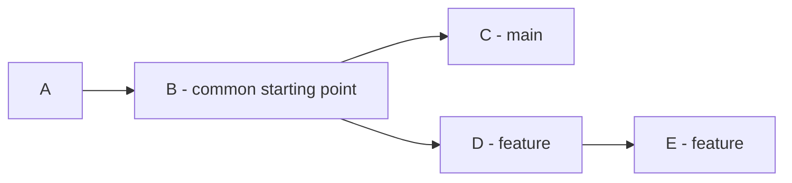
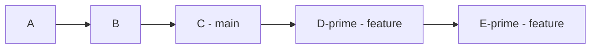
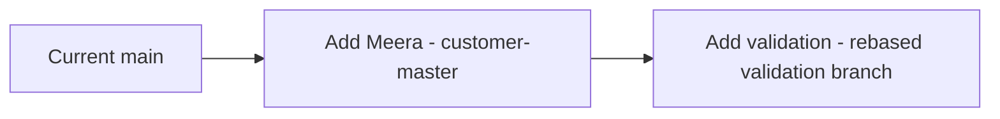

# Git Session 8 — Rebase and Industry Scenarios

**Tools:** Git Bash  
**Files:** `.txt` files created and changed through Git Bash  
**Environment:** One local practice repository; no GitHub is required

Git rebase is useful when a feature branch was created earlier and development has continued on another branch. Rebase can place the feature's commits on top of a newer starting point. It can also help combine several small commits into a cleaner history.

The exercises build on one repository. Each scenario has its own branch names and finishes with a clean working tree. Run the steps in order.

---

## 1. Understand what rebase changes

Imagine a feature branch was created when `main` was at commit B. After that, `main` received commit C, while the feature branch received commits D and E.

**Before rebase:**



Running `git rebase main` **while on the feature branch** tells Git to replay the feature's changes on top of C.

**After rebase:**



The changes introduced by D and E are normally preserved, but Git creates replacement commits D′ and E′ with **different commit IDs**. The feature branch moves to E′. `main` remains at C.

| Operation | What it does | Effect on history |
|---|---|---|
| `git merge main` while on a feature | Combines `main` into the feature | Preserves existing commits; a merge commit is usually created if histories diverged |
| `git rebase main` while on a feature | Replays the feature's commits after the latest `main` commit | Usually creates replacement feature commits with new IDs |
| `git cherry-pick <hash>` | Applies one selected commit's change to the current branch | Creates a new commit without bringing over the whole branch history |

**Remember:** Merge joins histories. Rebase rebuilds one branch's history on a different starting point. A rebase can also cause conflicts if two branches made incompatible changes.

---

## 2. Create the practice repository

Run this block **once** in Git Bash, from a location where a folder named `git-rebase-session8` does not already exist:

```bash
mkdir git-rebase-session8
cd git-rebase-session8
git init -b main

git config user.name "Git Student"
git config user.email "student@example.com"

printf '%s\n' 'C101,Anaya,Active' 'C102,Rahul,Active' > customers.txt
printf '%s\n' 'O101,C101,1500' > orders.txt

git add customers.txt orders.txt
git commit -m "Initial customer and order records"
git status
```

`git init -b main` creates a repository with the starting branch named `main`. The local `git config` commands set an author name and email only for this practice repository, so commits work without a GitHub account.

Small Git Bash commands used throughout the lesson:

| Syntax | Meaning |
|---|---|
| `printf '%s\n' 'text' > file.txt` | Create or **replace** a file; `>` overwrites its existing contents |
| `printf '%s\n' 'text' >> file.txt` | Add a line to the **end** of a file; `>>` keeps existing lines |
| `cat file.txt` | Display the current file contents |
| `git status` | Show the current branch, staged changes, and unstaged changes |
| `git log --oneline --graph --all --decorate` | Show compact commit history, branch connections, and labels such as `main` and `HEAD` |

`printf` is a Git Bash command used to edit text files. `%s\n` prints each quoted value on a separate line.

---

## Scenario 1 — Your feature branch is behind main

**Situation:** You are adding customer contact details on a feature branch. Another developer adds orders on `main`. You want your contact changes to sit on top of the latest version of `main`, without losing either set of changes.

### Step 1. Create two commits on the feature branch

```bash
git switch -c feature/customer-contact

printf '%s\n' 'C101,anaya@example.com' > contacts.txt
git add contacts.txt
git commit -m "Add Anaya contact"

printf '%s\n' 'C102,rahul@example.com' >> contacts.txt
git add contacts.txt
git commit -m "Add Rahul contact"

git log --oneline -3
```

`git switch -c` creates a branch and switches to it; `-c` means **create**. There are now two commits on `feature/customer-contact`. `main` has not received them.

### Step 2. Make a separate new commit on main

```bash
git switch main
printf '%s\n' 'O102,C102,2200' >> orders.txt

git add orders.txt
git commit -m "Add order O102 on main"

git log --oneline --graph --all --decorate
```

Now both branches have new commits after their shared starting point. The graph shows two separate lines of development.

### Step 3. Rebase the feature onto main

```bash
git switch feature/customer-contact
git rebase main

git log --oneline --graph --all --decorate
git status
```

`git rebase main` uses the latest commit on `main` as the new starting point. Git replays **both** contact commits after the new order commit. Their commit IDs change because their parent history has changed.

**Check:** `orders.txt` contains O102, `contacts.txt` contains both contacts, and HEAD is attached to `feature/customer-contact` after the successful rebase. The `main` branch itself has not moved.

### Step 4. Bring the completed feature into main

```bash
git switch main
git merge --ff-only feature/customer-contact

git log --oneline --graph --all --decorate
cat contacts.txt
cat orders.txt
```

`--ff-only` means **fast-forward only**. Git may move `main` forward to the feature's latest commit, but it must not create a separate merge commit. This succeeds because the rebased feature is now directly ahead of `main`.

```bash
git branch -d feature/customer-contact
git status
```

`-d` deletes the branch name only when Git considers it safely merged. The contact changes remain in `main`.

**Industry use:** A developer updates a local feature branch with newer project changes before final testing or review. Rebasing is generally safest when those feature commits have **not already been shared** with other developers.

---

## Scenario 2 — Rebase finds conflicting changes

**Situation:** You change Anaya's status to `Verified` on a feature branch. Another developer changes the same line to `Pending` on `main`. Git cannot choose which status is correct without a decision.

### Step 1. Make the feature change

```bash
git switch main
git switch -c feature/customer-status

printf '%s\n' 'C101,Anaya,Verified' 'C102,Rahul,Active' > customers.txt

git add customers.txt
git commit -m "Verify Anaya on feature"
```

The feature branch now contains `Verified`, while `main` still contains the original `Active` value.

### Step 2. Make a different change on main

```bash
git switch main
printf '%s\n' 'C101,Anaya,Pending' 'C102,Rahul,Active' > customers.txt

git add customers.txt
git commit -m "Mark Anaya as pending on main"

git log --oneline --graph --all --decorate
```

The two branches now have different changes to the **same line** since their shared starting commit.

### Step 3. Try rebasing the feature

```bash
git switch feature/customer-status
git rebase main
```

Git will report a conflict. This is the **expected result**, not a problem with the exercise. Git applies the `main` version first, then tries to replay the feature's `Verified` change.

```bash
git status
cat customers.txt
cat .git/HEAD
```

`git status` identifies the file with a conflict. `customers.txt` contains conflict markers similar to these:

```text
<<<<<<< HEAD
C101,Anaya,Pending
=======
C101,Anaya,Verified
>>>>>>> ... (Verify Anaya on feature)
```

The content above `=======` is the version currently checked out during the rebase; the content below it is from the feature commit being replayed. The marker after `>>>>>>>` can contain a commit ID or message. During the rebase, Git may temporarily have a **detached HEAD**. `cat .git/HEAD` lets you inspect that directly.

### Step 4. Cancel this first attempt and verify recovery

```bash
git rebase --abort
git status
cat customers.txt
```

`--abort` cancels the entire rebase attempt and returns the feature branch to its original position before the rebase. `customers.txt` shows `Verified` again on the feature branch. The `main` branch's `Pending` commit remains unchanged.

This is useful if you discover that you are not ready to resolve a conflict.

### Step 5. Repeat the rebase and resolve the conflict

```bash
git rebase main
```

The same conflict occurs again. For this exercise, the chosen final status is **Verified**. Replace the conflict-marker content with the correct file:

```bash
printf '%s\n' 'C101,Anaya,Verified' 'C102,Rahul,Active' > customers.txt

git add customers.txt
git status
```

`git add customers.txt` tells Git that the conflict in this file has been resolved and stages the chosen content. Git does **not** decide the business value; you choose the correct status.

```bash
GIT_EDITOR=true git rebase --continue

git status
cat customers.txt
git log --oneline --graph --all --decorate
```

`git rebase --continue` resumes replaying commits after the conflict is resolved. `GIT_EDITOR=true` is a **one-command Git Bash setting** that accepts the existing commit message instead of opening a text editor; it does not change Git's permanent configuration. If more commits cause conflicts, resolve each one and run `git rebase --continue` again.

**Check:** The feature branch contains `Verified`, its history is built on top of `main`'s `Pending` commit, and HEAD is attached to `feature/customer-status` after the rebase finishes.

### Step 6. Accept the finished feature on main

```bash
git switch main
git merge --ff-only feature/customer-status
cat customers.txt

git branch -d feature/customer-status
git status
```

The current customer status is `Verified`. The earlier `Pending` commit remains visible in Git history, but the later feature commit changed the value again.

| During a rebase | Meaning |
|---|---|
| `git rebase --continue` | Continue after fixing and staging conflicted files |
| `git rebase --abort` | Cancel the rebase and return to its original state |
| `git rebase --skip` | Skip the current commit being replayed; **its changes may be lost from the new history** |

**Industry use:** Two developers independently modify the same validation logic or customer rule. A rebase integrates the newer main history and asks for a decision when changes cannot be combined automatically.

---

## Scenario 3 — Combine three small commits into one

**Situation:** You implemented one small report feature, but created three commits while refining it. Before sharing the feature, you want its history to show **one meaningful commit**.

This uses **interactive rebase**. It can change commit IDs even when the finished file contents stay the same.

### Step 1. Create three commits for one feature

```bash
git switch main
git switch -c feature/daily-report

printf '%s\n' 'Daily customer report' > report.txt
git add report.txt
git commit -m "Create report"

printf '%s\n' 'Include active customers' >> report.txt
git add report.txt
git commit -m "Add report filter"

printf '%s\n' 'Show record count' >> report.txt
git add report.txt
git commit -m "Complete report details"
```

All three commits belong to the same report feature. Verify that the file has three lines and the branch has three new commits:

```bash
cat report.txt
git log --oneline main..feature/daily-report
```

`main..feature/daily-report` means **commits reachable from the feature branch but not from `main`**.

### Step 2. Understand the interactive rebase list

`git rebase -i HEAD~3` normally opens an editor with the last three commits in **oldest-to-newest** order. `-i` means **interactive**; `HEAD~3` is three parent steps behind the current commit.

The editor's initial actions look like this (commit IDs will differ):

```text
pick aaaaaaa Create report
pick bbbbbbb Add report filter
pick ccccccc Complete report details
```

To combine all three changes into the first commit, change the second and third `pick` actions to `fixup`:

```text
pick aaaaaaa Create report
fixup bbbbbbb Add report filter
fixup ccccccc Complete report details
```

- `pick` keeps the selected commit as a separate commit.
- `fixup` combines its changes with the previous commit and discards the fixed-up commit's message.
- `squash` also combines changes but allows the combined commit message to be edited.

### Step 3. Run the exact same operation without opening an editor

For a Git Bash-only exercise, this command makes those two `fixup` changes automatically:

```bash
GIT_SEQUENCE_EDITOR="sed -i '2,3s/^pick /fixup /'" git rebase -i HEAD~3
```

`GIT_SEQUENCE_EDITOR` tells Git which program should edit the rebase list for this one command. `sed -i` updates that list in place. `2,3` selects its second and third commit lines, and `s/^pick /fixup /` replaces the word `pick` at the start of those lines with `fixup`.

The command runs the **same interactive-rebase operation** as the edited list shown above. In normal development, you can instead run `git rebase -i HEAD~3`, change those two words in your editor, and save the file. **Use one approach, not both, for this exercise.**

### Step 4. Confirm the result

```bash
git log --oneline main..feature/daily-report
cat report.txt
git status
```

The branch now has **one new commit**, but `report.txt` still contains all three lines. The combined commit retains the first message, `Create report`.

```bash
git switch main
git merge --ff-only feature/daily-report
git branch -d feature/daily-report
```

**Industry use:** Cleaning up local, unpublished feature commits before code review. Avoid rewriting commits that colleagues already rely on unless the team has agreed on how to handle the rewritten history.

---

## Scenario 4 — One feature needs another feature's changes

**Situation:** One developer is adding customer Meera to the master records. Another developer is building a validation rule for Meera. The validation rule needs the master change, but neither feature has been merged into `main` yet.

### Step 1. Build the customer-master feature

```bash
git switch main
git switch -c feature/customer-master

printf '%s\n' 'C103,Meera,Active' >> customers.txt

git add customers.txt
git commit -m "Add customer Meera"
```

The new customer exists on `feature/customer-master`, but not yet on `main`.

### Step 2. Build the validation feature separately

```bash
git switch main
git switch -c feature/customer-validation

printf '%s\n' 'C103,Meera,Status must be Active' > validation-rules.txt

git add validation-rules.txt
git commit -m "Add validation rule for Meera"

git log --oneline --graph --all --decorate
```

The validation branch was created from `main`, so it has the validation file but **not** the new Meera record from the other feature branch.

### Step 3. Rebase validation onto customer-master

```bash
git rebase feature/customer-master

git log --oneline --graph --all --decorate
cat customers.txt
cat validation-rules.txt
```

Git replays the validation commit on top of the customer-master commit. The validation branch now contains **both** the Meera record and its validation rule. `feature/customer-master` and `main` have not moved.



This illustrates the new dependency: the validation commit now comes **after** the master commit.

### Step 4. Bring both completed features into main

```bash
git switch main
git merge --ff-only feature/customer-master
git merge --ff-only feature/customer-validation

git log --oneline --graph --all --decorate
cat customers.txt
cat validation-rules.txt
```

The first merge moves `main` to the customer-master commit. The second moves `main` to the validation commit. Both can fast-forward because the validation branch was rebased on top of the master branch.

```bash
git branch -d feature/customer-validation
git branch -d feature/customer-master
git status
```

**Industry use:** One feature needs a data structure, API, or configuration change from another feature that has not yet been merged. This is useful for coordinated development, but changes to a shared base branch should be communicated carefully.

---

## 3. HEAD and commit history during rebase

| Moment | HEAD behavior |
|---|---|
| Before rebase, while on a feature branch | HEAD is attached to that branch |
| While Git is replaying commits | HEAD may be temporarily detached |
| A rebase stops because of a conflict | Git is in a rebase-in-progress state; check `git status` |
| After successful rebase | HEAD is attached to the original feature branch, which points to its new tip |
| After `git rebase --abort` | The original feature branch and its pre-rebase position are restored |

Rebase usually **recreates commits** rather than moving the old commit objects. That's why the commit hashes can change. Reflog may help locate earlier branch positions if recovery is needed, but it is not a permanent backup.

Check the current state whenever unsure:

```bash
git status
cat .git/HEAD
git log --oneline --graph --all --decorate -12
```

A `.git/HEAD` line like `ref: refs/heads/main` or `ref: refs/heads/feature/...` means HEAD is attached to that branch. A raw commit hash means HEAD is detached. These examples use a normal, non-worktree practice repository.

## 4. Choosing merge or rebase

| Situation | Usually consider | Reason |
|---|---|---|
| Combine a completed feature into main | Merge | Integrates the feature into the target branch |
| Update your own unpublished feature with newer main commits | Rebase | Replays your changes after the newer main history |
| Preserve the original branch history exactly | Merge | Does not rewrite existing feature commits |
| Clean up multiple unpublished commits in one feature | Interactive rebase | Combines or reorganizes commits before review |
| Bring exactly one selected commit from another branch | Cherry-pick | Selects changes without integrating all branch history |
| Changes are already being used by other developers | Avoid an uncoordinated rebase | Rewritten commit IDs can disrupt other people's branches |

**Key points:**

- Rebase **does not automatically remove merge conflicts**; conflicts may appear while commits are replayed.
- Rebase changes the feature branch's commit ancestry, not the current tip of `main`.
- `--continue` resumes after resolving a conflict; `--abort` cancels the operation; `--skip` can omit a commit's changes.
- `fixup` and `squash` are interactive rebase actions for combining commits, not commands for switching branches.
- Before rebasing real work, check `git status`. Start with a clean working tree and staging area.
