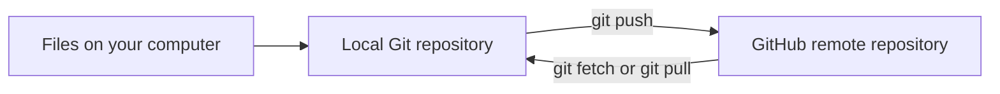
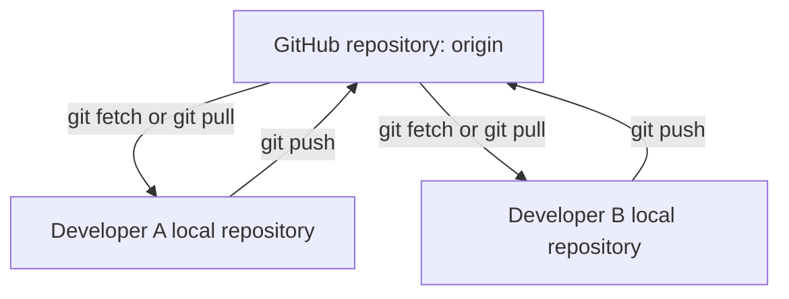

# Git Session 9 — GitHub Authentication and Remote Repositories

**Environment:** Windows, Git Bash, GitHub CLI (`gh`) and GitHub.com  
**Practice:** One private GitHub repository and two local folders on the same computer  
**Files:** `customers.txt` and `orders.txt`

## 1. Understand the three tools

| Term | Simple meaning |
|---|---|
| **Git** | Tracks file changes and commits on your computer. |
| **GitHub** | Hosts a Git repository online so others can access it with permission. |
| **GitHub CLI (`gh`)** | Lets you log in to GitHub and manage GitHub repositories from a terminal. |
| **Git Bash** | The terminal where the Git and `gh` commands are entered. |



**Before starting:** You need an existing GitHub account and internet access. Git itself is already installed. Use a practice repository, not a company or production repository.

---

## 2. Install GitHub CLI on Windows

### Step 1 — Check if `gh` is available

Run in **Git Bash**:

```bash
gh --version
```

If a version appears, continue to Section 3. If Git Bash says `gh: command not found`, install it.

### Step 2 — Install `gh` if needed

Open **Windows PowerShell** and run:

```powershell
winget install --id GitHub.cli --source winget
```

`winget` is the Windows package manager. This command installs the official GitHub CLI package; it does **not** install or replace Git.

Close **all** Git Bash / terminal windows after installation, then open a new Git Bash window:

```bash
gh --version
```

You should now see the installed GitHub CLI version. If `winget` is unavailable, use the official Windows installer: https://cli.github.com/.

---

## 3. Log in to GitHub through the browser

### Step 1 — Start browser authentication

Run in **Git Bash**:

```bash
gh auth login --hostname github.com --git-protocol https --web
```

GitHub CLI opens the browser-based sign-in process. Follow the displayed steps, enter the one-time code if prompted, sign in, and authorize **GitHub CLI**. A normal GitHub account password is not entered into Git Bash for Git pushes.

| Part of the command | Meaning |
|---|---|
| `gh auth login` | Sign in to a GitHub account from GitHub CLI. |
| `--hostname github.com` | Use GitHub.com rather than a company-hosted GitHub server. |
| `--git-protocol https` | Use HTTPS URLs for Git operations in this exercise. |
| `--web` | Start the browser-based authentication flow. |

### Step 2 — Check which account is active

```bash
gh auth status
gh auth status --active --hostname github.com
gh api user --jq '.login'
```

- `gh auth status` lists the signed-in accounts and indicates which is active.
- `--active` shows only the active account; `--hostname` limits the check to GitHub.com.
- `gh api user --jq '.login'` prints the username of the account currently used for GitHub API requests. `--jq` selects just the `login` field from the result.

**If more than one account is signed in:**

```bash
gh auth switch --hostname github.com
gh auth status --active --hostname github.com
```

The first command lets you select the active account. To select a username directly, use `gh auth switch --hostname github.com --user USERNAME`, replacing `USERNAME` with the actual account name. Account switching changes the `gh` account used for GitHub operations; it does not change Git commit author settings.

### Step 3 — Let Git use the GitHub login for HTTPS

```bash
gh auth setup-git
```

This configures Git to use GitHub CLI as a credential helper for authenticated GitHub hosts. A **credential helper** gives Git the authentication it needs when pushing to or fetching from a protected remote repository.

**Two identities to keep separate:**

| Git commit author | GitHub authenticated account |
|---|---|
| `git config user.name` and `git config user.email` | `gh auth status --active` |
| Recorded in commits as author details | Used to authorize operations on GitHub |
| Does not itself sign you in | Does not automatically change commit author information |

If your earlier Git exercises already used commits, your author details are probably configured. Verify them:

```bash
git config --global user.name
git config --global user.email
```

If a value is missing, configure it with **your own real name and preferred Git commit email**, not another person's details, before committing.

---

## 4. Create a local project and its first commit

### Step 1 — Make two separate local working folders

Stay in **one Git Bash window** for the exercises below. The variables created later will be reused in that window.

```bash
LAB="git-remote-lab-$(date +%Y%m%d%H%M%S)"
mkdir "$LAB"
cd "$LAB"
mkdir developer-a
cd developer-a
git init -b main
```

- `LAB=...` stores a unique folder name for this practice session. `date` adds the current date and time so the folder name is unlikely to be reused.
- `mkdir` creates folders; `cd` enters them.
- `git init -b main` creates the local Git repository and names the initial branch `main`. The `-b` option sets that branch name.

### Step 2 — Create and commit customer data

```bash
printf '%s\n' 'C101,Anaya,Active' > customers.txt
cat customers.txt
git add customers.txt
git commit -m "Initial customer records"
git status
```

- `printf` writes the line into the file. `>` creates or replaces the file; `>>` (used later) adds a line without removing existing lines.
- `cat` displays file content in Git Bash.
- `git add` selects the current file content for the next commit.
- `git commit -m` saves a commit using the message written after `-m`.

**Check:** `customers.txt` contains Anaya, and `git status` reports a clean working tree. Nothing has been uploaded to GitHub yet.

---

## 5. Create a remote repository on GitHub

### Step 1 — Create an empty private repository

```bash
OWNER="$(gh api user --jq '.login')"
REPO="git-remote-practice-$(date +%Y%m%d%H%M%S)"
gh repo create "$OWNER/$REPO" --private
```

- `OWNER` stores your active GitHub username.
- `REPO` stores a unique repository name.
- `gh repo create` creates the repository on GitHub. `--private` makes it accessible only to permitted accounts.
- `OWNER/REPO` identifies the repository's owner and name. Do **not** select an option to add a README or initial files; the first commit already exists locally.

**Check:** The GitHub repository exists, but your local files have not been pushed yet. This is deliberate: the next section shows the connection explicitly.

### Step 2 — Connect the local repository to GitHub

```bash
git remote add origin "https://github.com/$OWNER/$REPO.git"
git remote -v
```

`git remote add` saves the GitHub repository URL inside the local Git configuration. `origin` is just the usual short name for that URL; it is **not** a branch and is not a Git command. `git remote -v` displays the saved fetch and push URLs.

### Step 3 — Push the local commit for the first time

```bash
git push -u origin main
git branch -vv
gh repo view "$OWNER/$REPO"
```

- `git push` sends **commits** on local `main` to the GitHub repository named `origin`; uncommitted changes are not sent.
- `-u` means **set upstream**. It records that local `main` tracks `origin/main`, so future pushes and pulls can usually use just `git push` or `git pull`.
- `git branch -vv` shows branch tracking information; `gh repo view` displays the GitHub repository details.

**Check:** GitHub now contains `customers.txt` and the first commit.

---

## 6. Understand `main`, `origin` and `origin/main`

| Name | Meaning |
|---|---|
| `main` | Your local branch. |
| `origin` | Short name for the remote GitHub repository URL. |
| `origin/main` | Your local **remote-tracking reference**: Git's last known position of `main` on `origin`. |
| `HEAD` | The current checkout position; normally attached to your current local branch. |

`origin/main` is updated by operations such as `git fetch` and `git push`. It is not a second local working folder, and it does not necessarily reflect a remote change until your local Git learns about it.



---

## 7. Simulate two developers using two folders

Both folders are on one computer, but they are **separate Git repositories**. Changes in one do not automatically appear in the other.

### Step 1 — Clone the GitHub repository into Developer B's folder

You are currently inside `developer-a`.

```bash
cd ..
git clone "https://github.com/$OWNER/$REPO.git" developer-b
cd developer-b
git remote -v
git branch -vv
cat customers.txt
```

- `cd ..` goes up to the practice folder containing `developer-a`.
- `git clone` downloads the remote repository and its commit history into a new folder, `developer-b`. It also configures `origin` automatically.
- `git init` creates a new empty local repository; **`git clone` copies an existing repository**.

**Check:** Developer B sees Anaya in `customers.txt`, and `main` tracks `origin/main`.

### Step 2 — Developer B adds Rahul and pushes

```bash
printf '%s\n' 'C102,Rahul,Active' >> customers.txt
cat customers.txt
git add customers.txt
git commit -m "Add customer Rahul"
git push
```

Developer B creates a second commit and sends it to GitHub. No `-u` is needed because cloning configured the upstream branch.

**Check:** Developer B and GitHub contain Anaya and Rahul. Developer A still has only Anaya locally.

---

## 8. Fetch changes without changing local files

### Step 1 — Return to Developer A and inspect

```bash
cd ../developer-a
cat customers.txt
git status -sb
git fetch origin
git status -sb
git log --oneline --graph --all --decorate
```

- `git fetch origin` downloads the latest remote commits and updates `origin/main`.
- `-s` in `git status -sb` gives short status, and `-b` adds branch tracking information.
- `--oneline` shortens commit lines; `--graph` draws their connections; `--all` includes other local references; `--decorate` displays branch names and HEAD labels.

**Expected:** After fetching, local `main` is **behind** `origin/main` by one commit. The actual `customers.txt` file in Developer A's folder still contains only Anaya.

### Step 2 — Inspect the remote change before integrating it

```bash
git diff main..origin/main -- customers.txt
cat customers.txt
```

`git diff main..origin/main` compares the file versions at those two branch tips. `-- customers.txt` limits the comparison to that file. Git shows Rahul in the downloaded remote version, but the working file is unchanged.

### Step 3 — Bring the remote change into Developer A's `main`

```bash
git pull --ff-only
cat customers.txt
git status -sb
```

- `git pull` fetches changes and integrates them into the current branch.
- `--ff-only` means **fast-forward only**: update the branch only if Git can do so without creating a merge commit. If both branches have independent commits, it stops instead of guessing how to combine them.

**Check:** Developer A now has both Anaya and Rahul. Local `main` and `origin/main` point to the same commit.

### Fetch vs pull

| Command | Downloads remote commits? | Changes your current local branch/files? |
|---|---|---|
| `git fetch origin` | Yes | No — it updates remote-tracking references such as `origin/main`. |
| `git pull --ff-only` | Yes | Yes, if a fast-forward is possible; otherwise it refuses. |
| `git push` | Sends local commits to remote | Does not update another developer's local working files. |

---

## 9. A push is rejected because another developer pushed first

**Situation:** Developer A and Developer B start from the same shared history. They each create a new local commit, but Developer A pushes first. Developer B then tries to push without integrating A's commit.

### Step 1 — Developer A pushes a customer change

You are currently inside `developer-a`.

```bash
printf '%s\n' 'C103,Meera,Active' >> customers.txt
git add customers.txt
git commit -m "Add customer Meera"
git push
```

**Check:** GitHub now has Meera's commit. Developer B has not fetched it yet.

### Step 2 — Developer B creates an independent order commit

```bash
cd ../developer-b
printf '%s\n' 'O201,C101,1500' > orders.txt
git add orders.txt
git commit -m "Add order O201"
git push
```

The last command is **expected to be rejected** as a non-fast-forward push. It is not an authentication failure: GitHub has a commit from Developer A that Developer B has not integrated.

**Do not use `git push --force` to fix this.** Force-pushing can replace shared branch history.

### Step 3 — Fetch, merge and push safely

```bash
git fetch origin
git log --oneline --graph --all --decorate
git merge --no-edit origin/main
git push
git status -sb
```

- `git fetch origin` downloads Meera's commit, but keeps Developer B's branch unchanged.
- `git merge origin/main` combines the downloaded `origin/main` history with Developer B's local `main`.
- `--no-edit` accepts Git's automatic merge commit message without opening an editor.
- Because the changes were made in different files (`customers.txt` and `orders.txt`), Git should merge them automatically in this example.

**Check:** GitHub now contains both Meera and order O201, with a merge commit recording the combined histories.

### Step 4 — Developer A retrieves the completed merge

```bash
cd ../developer-a
git pull --ff-only
cat customers.txt
cat orders.txt
git log --oneline --graph --all --decorate -7
```

**Check:** Developer A now has Anaya, Rahul, Meera, and order O201. Both local working folders have the shared result.

---

## 10. Common first-time errors

| Message or situation | What it usually means | What to check |
|---|---|---|
| `gh: command not found` | GitHub CLI is missing or the terminal still has the old PATH. | Install `gh`, close all terminal windows, then reopen Git Bash. |
| `You are not logged into any GitHub hosts` | GitHub CLI has no usable login. | Run `gh auth login --hostname github.com --git-protocol https --web`. |
| `Author identity unknown` | Git does not know the commit author details. | Check `git config --global user.name` and `user.email`; set your own values. |
| `remote origin already exists` | The local repository already has a remote named `origin`. | Run `git remote -v`; do not add it again. |
| `Repository not found` | URL is incorrect, repository does not exist, or the active account lacks permission. | Check `git remote -v`, `gh auth status --active`, and the GitHub repository name. |
| `Permission denied` or HTTP 403 | Git is using the wrong account or lacks access. | Check the active account, `gh auth setup-git`, and repository permissions. |
| `rejected (fetch first)` or `non-fast-forward` | The remote branch has commits missing from your local branch. | Fetch, inspect, then merge or rebase safely before pushing. |
| `fatal: Not possible to fast-forward` | Both histories moved independently. | Inspect `git log --graph --all`; choose an appropriate merge or rebase strategy. |

For account selection, `gh auth switch --hostname github.com` changes the active account if multiple accounts are signed in. If Git is using a different credential helper or an environment-provided token, check that configuration as well.

---

## 11. Quick reference

| Command | Purpose |
|---|---|
| `gh --version` | Check whether GitHub CLI is installed. |
| `gh auth login --web` | Sign in to GitHub using the browser. |
| `gh auth status` | Check authenticated accounts and the active account. |
| `gh auth switch` | Change active authenticated account. |
| `gh auth setup-git` | Configure Git to authenticate through GitHub CLI. |
| `gh repo create NAME --private` | Create a private GitHub repository. |
| `git remote add origin URL` | Connect the local repository to a remote URL. |
| `git remote -v` | View saved remote URLs. |
| `git push -u origin main` | First push and set upstream tracking. |
| `git clone URL FOLDER` | Copy a remote repository into a new local folder. |
| `git fetch origin` | Download new remote commits without changing current files. |
| `git pull --ff-only` | Fetch and fast-forward the current branch if possible. |
| `git merge --no-edit origin/main` | Merge fetched remote history using the default merge message. |
| `git log --oneline --graph --all --decorate` | View local and remote-tracking commit history together. |

**Final idea:** Your local repository contains your work and commit history. GitHub hosts a shared remote repository. `push` sends commits to GitHub, `fetch` updates what you know about GitHub, and `pull` fetches and integrates changes into your current branch.

### Official references

- [Install GitHub CLI on Windows](https://github.com/cli/cli/blob/trunk/docs/install_windows.md)
- [GitHub CLI login](https://cli.github.com/manual/gh_auth_login)
- [GitHub CLI accounts](https://cli.github.com/manual/gh_auth_status)
- [Configure Git authentication](https://cli.github.com/manual/gh_auth_setup-git)
- [Create a GitHub repository](https://cli.github.com/manual/gh_repo_create)
