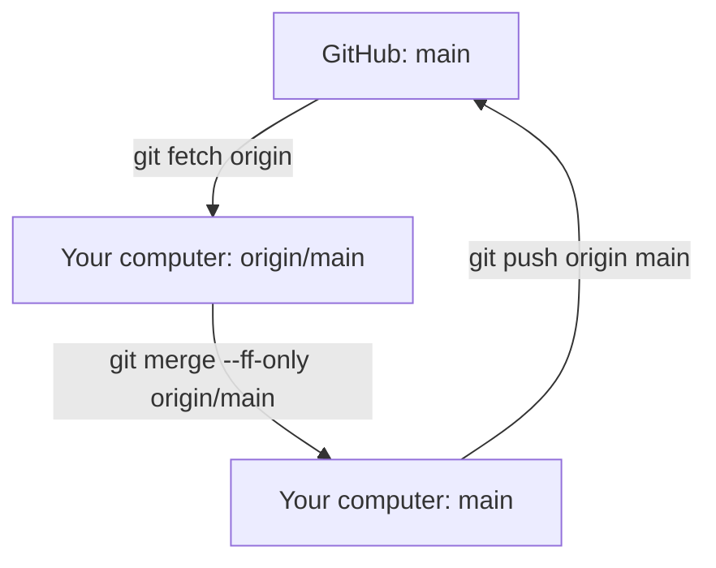
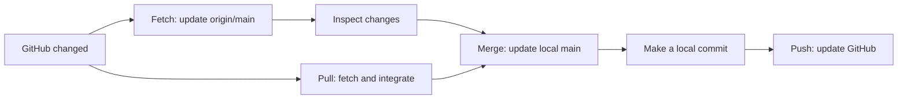

# Git Session 10 — Local and Remote Repositories

**Tools:** Git Bash on Windows and GitHub in a web browser  
**Practice project:** `git-remote-practice-10`  
**Main topics:** `origin`, `main`, `origin/main`, `fetch`, `merge`, `pull`, and `push`

> **Starting point:** Git is installed, GitHub login is working, and a new practice folder can be created. Use one local repository and one GitHub repository throughout the five scenarios. Keep all practice changes on `main`.

## How local and remote Git work together

A **local repository** lives on your computer. A **remote repository** is a shared repository, such as one hosted on GitHub.

Three names will appear during the exercises:

| Name | Where it exists | What it means |
|---|---|---|
| `main` | Your computer | Your local working branch. Its commit determines the version checked out in your working files. |
| `origin/main` | Your computer | Your last known position of the `main` branch on GitHub. It is called a **remote-tracking branch**. |
| `main` on GitHub | GitHub | The actual `main` branch stored on the remote server. |

`origin` is simply the nickname of a remote repository URL. It does **not** mean a branch or a separate GitHub account.



**Important:** `origin/main` is stored locally. It does not continuously update itself when someone changes GitHub. Fetching updates your local information about GitHub.

---

## Scenario 1 — Share a local project with the team

**Situation:** A project already contains several saved versions on your computer. The team now needs those files and commits on GitHub.

### Step 1. Create a new local repository

Open Git Bash in a folder where you want to keep the project. Use a folder name that does not already exist.

```bash
mkdir git-remote-practice-10
cd git-remote-practice-10
git init -b main
git status
```

`mkdir` creates the folder, `cd` enters it, and `git init -b main` starts a repository with `main` as its first branch. `git status` checks the current branch and pending changes. The `-b` option selects the starting branch name.

Git must also know the author of each commit. To check the existing values, run:

```bash
git config --get user.name
git config --get user.email
```

If either value is missing, set it using your own name and email address before making commits:

```bash
git config --global user.name "Your Name"
git config --global user.email "your-email@example.com"
```

`--global` saves the author setting for your Windows user account. Replace the examples with your own details. **Git commit identity and GitHub login are different things.**

### Step 2. Save five meaningful commits

Each block creates one commit. Run the blocks in order.

**Commit C1 — Start customer records**

```bash
printf '%s\n' 'C101,Anaya,Active' > customers.txt
git add customers.txt
git commit -m "Create customer records"
```

`printf` writes text into the file. `>` creates or replaces file contents. `git add` selects that version for the next commit; `git commit -m` saves it with the message inside quotes.

**Commit C2 — Add Rahul**

```bash
printf '%s\n' 'C102,Rahul,Active' >> customers.txt
git add customers.txt
git commit -m "Add customer Rahul"
```

`>>` adds a line at the end without deleting the earlier line.

**Commit C3 — Start order records**

```bash
printf '%s\n' 'O101,C101,1500' > orders.txt
git add orders.txt
git commit -m "Create order records"
```

**Commit C4 — Add another order**

```bash
printf '%s\n' 'O102,C102,2200' >> orders.txt
git add orders.txt
git commit -m "Add order O102"
```

**Commit C5 — Add Riya**

```bash
printf '%s\n' 'C103,Riya,Active' >> customers.txt
git add customers.txt
git commit -m "Add customer Riya"
```

Check the files and history:

```bash
cat customers.txt
cat orders.txt
git log --oneline
```

`cat` displays file contents. `git log --oneline` displays the saved commits with short commit IDs. There should be **five commits**. C1–C5 are labels used here; actual Git hashes will be different.

### Step 3. Create an empty repository on GitHub

1. Open [github.com](https://github.com) and sign in.
2. Select the **+** menu, then **New repository**.
3. Select your own account as **Owner**.
4. Enter **Repository name:** `git-remote-practice-10`.
5. Choose **Private** or **Public**. Either works for this practice.
6. **Do not add** a README, `.gitignore`, or license. The existing local repository already has commits.
7. Select **Create repository**.
8. On the new repository page, copy its **HTTPS repository URL**. It should look similar to `https://github.com/USERNAME/git-remote-practice-10.git`.

### Step 4. Connect the local repository and send the commits

Replace `YOUR-USERNAME` with your GitHub username before running the first command:

```bash
git remote add origin https://github.com/YOUR-USERNAME/git-remote-practice-10.git
git remote -v
```

`git remote add origin` stores the GitHub URL under the short name `origin`. `git remote -v` displays the saved remote URL used for fetching and pushing. Do not type `YOUR-USERNAME` literally.

```bash
git push -u origin main
git status
git log --oneline --graph --all --decorate
```

`git push` uploads local commits to GitHub. `origin` chooses the remote; `main` chooses the branch. `-u` connects local `main` to its upstream `origin/main`, making future `git push` and `git pull` commands easier. `--graph` draws history lines, `--all` includes available references, and `--decorate` labels them.

**Expected result:** Refresh the GitHub page. Both files and all five commits should be visible. Local `main`, local `origin/main`, and GitHub's `main` now point to C5.

---

## Scenario 2 — A teammate updates GitHub, but your local files do not change

**Situation:** Another developer has updated the shared repository. You want to download the new commit information **without changing your working files yet**.

### Step 1. Make one commit using GitHub's website

1. On the GitHub repository page, confirm the selected branch is **main**.
2. Open `customers.txt` and select the **pencil / Edit this file** action.
3. Add this line at the end:

   ```text
   C104,Meera,Active
   ```

4. Select **Commit changes...**.
5. Enter the message `Add customer Meera on GitHub`.
6. Choose **Commit directly to the main branch**, if that option is presented, and confirm.

This creates **C6 on GitHub only**. It does not change the local repository until Git communicates with GitHub.

### Step 2. Check your local copy before fetching

```bash
cat customers.txt
git log --oneline -3
```

`cat` still shows only Anaya, Rahul, and Riya. `git log -3` shows the latest three local commits. Meera is not visible yet.

### Step 3. Fetch GitHub changes

```bash
git fetch origin
git log --oneline --graph --all --decorate
cat customers.txt
```

`git fetch origin` downloads new commits from GitHub and updates local remote-tracking references such as `origin/main`. **It does not move local `main` or replace the working files.**

**Expected result:** The graph shows `origin/main` at C6 and `main` at C5. `customers.txt` still does not contain Meera.

### Step 4. Look at the downloaded changes before accepting them

```bash
git log --oneline main..origin/main
git show origin/main:customers.txt
git diff main origin/main -- customers.txt
```

- `git log main..origin/main` lists commits known to `origin/main` that are not yet in local `main`.
- `git show origin/main:customers.txt` displays the file version saved at `origin/main`, without changing your actual file.
- `git diff main origin/main -- customers.txt` compares that file between the two commit positions. The `--` marks the start of the file name.

You should see Meera in the downloaded version, while your local working file remains unchanged.

---

## Scenario 3 — Review the fetched changes and bring them into local `main`

**Situation:** You have inspected C6 and decided to accept the new customer record into your local project.

### Step 1. Move local main forward

```bash
git switch main
git merge --ff-only origin/main
```

`git switch main` ensures you are updating the intended local branch. `git merge origin/main` brings the previously fetched changes into that branch. `--ff-only` means **fast-forward only**: Git moves `main` forward if the history allows it; otherwise Git stops instead of creating a merge commit.

### Step 2. Verify what changed

```bash
cat customers.txt
git status
git log --oneline --graph --all --decorate
```

**Expected result:** `customers.txt` now includes Meera, and `main` and `origin/main` both point to C6. No additional merge commit was needed because `main` was simply behind.

**Difference to remember:** `fetch` downloads and updates `origin/main`; `merge` updates your actual local `main`. These are separate actions.

---

## Scenario 4 — Get the latest GitHub changes using one command

**Situation:** Another teammate commits a new order on GitHub. This time you want to download **and** integrate it in one step.

### Step 1. Make another GitHub website commit

1. In the same GitHub repository, select **main** and open `orders.txt`.
2. Select the pencil icon to edit the file.
3. Add this line:

   ```text
   O103,C104,1800
   ```

4. Select **Commit changes...**.
5. Use the message `Add order O103 on GitHub`.
6. Commit the change directly to `main`.

GitHub now has **C7**. Your local `main` is still at C6.

### Step 2. Pull the new commit into local main

```bash
git switch main
git pull --ff-only origin main
cat orders.txt
```

`git pull` first fetches GitHub changes, then integrates them into your current branch. `origin` names the remote and `main` names its branch. `--ff-only` allows the update only when the local branch can move directly forward. It refuses to combine diverged histories automatically.

**Expected result:** The local `orders.txt` includes O103. Local `main`, local `origin/main`, and GitHub's `main` now point to C7.

### Step 3. See the updated references

```bash
git status
git log --oneline --graph --all --decorate
```

In this exercise, `git pull --ff-only origin main` is the shorter alternative to running `git fetch origin` followed by `git merge --ff-only origin/main`.

---

## Scenario 5 — Share a new local commit with the team

**Situation:** You finish a customer change locally. The team cannot see it on GitHub until you push it.

### Step 1. Make and commit a local change

```bash
printf '%s\n' 'C105,Kiran,Active' >> customers.txt
git add customers.txt
git commit -m "Add customer Kiran locally"
git status
```

This creates **C8 on local `main`**. The change is committed on your computer, but GitHub still has C7. `git status` may report that your branch is one commit ahead of `origin/main`.

### Step 2. Observe the difference before pushing

```bash
git log --oneline --graph --all --decorate
git log --oneline origin/main..main
```

`origin/main..main` lists commits present on local `main` but not yet recorded in local `origin/main`. You should see the new Kiran commit.

### Step 3. Push the commit to GitHub

```bash
git push origin main
git status
git log --oneline --graph --all --decorate
```

`git push origin main` sends the new commit to GitHub's `main` branch. With a successful push, Git normally updates the local `origin/main` record as well.

**Expected result:** Refresh `customers.txt` on GitHub. Kiran is present, and all three branch positions are at C8.

---

## Reference — Which position changes after each operation?

| Action | Local `main` | Local `origin/main` | GitHub `main` |
|---|---|---|---|
| First successful push | C5 | C5 | C5 |
| Meera committed on GitHub | C5 | C5 | C6 |
| `git fetch origin` | C5 | C6 | C6 |
| `git merge --ff-only origin/main` | C6 | C6 | C6 |
| Order O103 committed on GitHub | C6 | C6 | C7 |
| `git pull --ff-only origin main` | C7 | C7 | C7 |
| Kiran committed locally | C8 | C7 | C7 |
| `git push origin main` | C8 | C8 | C8 |

C1–C8 are learning labels, not actual commit hashes. This sequence assumes no other changes are made to the GitHub repository during the exercises.

### Git commands at a glance

| Command | Downloads commits? | Moves local `main`? | Sends commits to GitHub? |
|---|---|---|---|
| `git fetch origin` | Yes | No | No |
| `git merge --ff-only origin/main` | No | Yes, when fast-forward is possible | No |
| `git pull --ff-only origin main` | Yes | Yes, when fast-forward is possible | No |
| `git push origin main` | No | No | Yes |



### Important distinctions

- **`main` versus `origin/main`:** Local work branch versus locally stored information about GitHub's branch.
- **`fetch` versus `pull`:** Fetch downloads information without changing checked-out files. Pull fetches and then integrates changes into the current branch.
- **`pull` versus `push`:** Pull brings changes from GitHub to your computer. Push sends local commits to GitHub.
- **`--ff-only`:** Integrate only when Git can move the branch forward without a merge commit. If both sides have new, different commits, this command stops; do not force-push to bypass the problem.
- **`-u`:** Sets the upstream relationship. It does not upload additional files or create an extra commit.

For this practice, all changes happen on `main`. In team projects, changes are commonly reviewed in feature branches and pull requests before entering a protected `main` branch.

### Official references

- [Create a GitHub repository](https://docs.github.com/en/repositories/creating-and-managing-repositories/creating-a-new-repository)
- [Edit a file on GitHub](https://docs.github.com/en/repositories/working-with-files/managing-files/editing-files)
- [Git fetch documentation](https://git-scm.com/docs/git-fetch)
- [Git pull documentation](https://git-scm.com/docs/git-pull)
