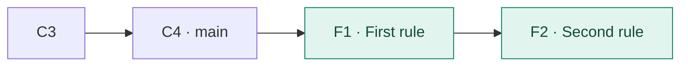
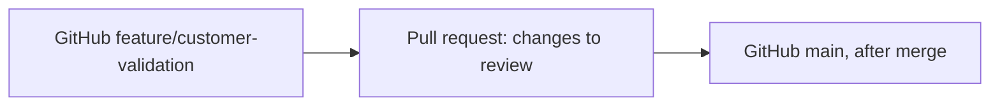
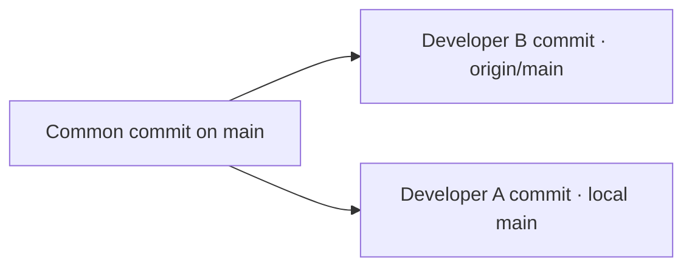

# Git Session 11 — Feature Branches, Pull Requests & Team Collaboration

**Environment:** Windows · Git Bash · GitHub · GitHub CLI (`gh`)

## What you will learn

By the end of these five scenarios, you will be able to:

- Develop a feature without changing `main`.
- Publish a local feature branch to GitHub.
- Open a pull request (PR) and understand **base** and **compare**.
- Update an existing PR after feedback, then merge it into GitHub's `main`.
- Understand and recover from a rejected push when another developer pushes first.

All scenarios use the **same new practice repository**. You do not need any files or branches from earlier sessions. A single GitHub account and one Windows computer are enough.

---

## Before starting — Create a fresh project

### Step 1. Check GitHub access

Open **Git Bash**:

```bash
git --version
gh --version
gh auth status
```

- `git --version` confirms Git is installed.
- `gh --version` confirms GitHub CLI is installed.
- `gh auth status` shows the active GitHub account and whether authentication is valid.

If GitHub CLI is not authenticated, run:

```bash
gh auth login --hostname github.com --git-protocol https --web
gh auth setup-git
```

Complete the browser login, then return to Git Bash. `gh auth setup-git` configures Git to use GitHub CLI credentials for HTTPS Git operations.

**Commit author versus GitHub login:** `git config user.name` and `user.email` record the author of commits. `gh auth login` controls which GitHub account is authenticated. They are not the same setting.

### Step 2. Create a new local repository

Run these commands from your preferred practice location. The example uses `D:/git_sessions`:

```bash
cd /d/git_sessions
mkdir git-team-collaboration-11
cd git-team-collaboration-11
git init -b main
```

- `mkdir` creates a folder.
- `cd` enters that folder.
- `git init -b main` creates a new Git repository with its initial branch named `main`.

Check your commit identity:

```bash
git config --get user.name
git config --get user.email
git status
```

If the name or email is missing, set it using your **own** name and email with `git config user.name` and `git config user.email` before committing.

### Step 3. Create four meaningful commits

**Commit C1 — Create customer records**

```bash
printf '%s\n' 'CustomerID,Name,Status' 'C101,Anaya,Active' > customers.csv
git add customers.csv
git commit -m "Create customer records"
```

**Commit C2 — Add another customer**

```bash
printf '%s\n' 'C102,Rahul,Active' >> customers.csv
git add customers.csv
git commit -m "Add customer Rahul"
```

**Commit C3 — Create order records**

```bash
printf '%s\n' 'OrderID,CustomerID,Amount' 'O101,C101,1500' > orders.csv
git add orders.csv
git commit -m "Create order records"
```

**Commit C4 — Add another order**

```bash
printf '%s\n' 'O102,C102,2200' >> orders.csv
git add orders.csv
git commit -m "Add order O102"
```

`>` creates or replaces a file. `>>` appends a new line. `git add` stages a file, and `git commit -m` saves a new commit with the given message.

Verify:

```bash
cat customers.csv
cat orders.csv
git log --oneline --graph --decorate
git status
```

**Expected:** Four commits on `main` and a clean working tree. C1–C4 are learning labels; Git generates real commit hashes.

### Step 4. Create the GitHub repository and publish `main`

```bash
gh repo create git-team-collaboration-11 --private --source=. --remote=origin --push
```

This single GitHub CLI command:

- Creates a **private** repository under the active GitHub account (`--private`).
- Uses the current local folder as the project (`--source=.`; `.` means *here*).
- Adds the GitHub repository as the local remote named `origin` (`--remote=origin`).
- Pushes the existing local commits to GitHub (`--push`).

**Use this creation method for the exercise.** Do not also create another repository with the same name on the GitHub website. If a repository with this name already exists in your account, choose a fresh name for **both** your local folder and GitHub repository before starting.

Check the connection:

```bash
git remote -v
git branch -vv
git log --oneline --graph --all --decorate
gh repo view --web
```

`gh repo view --web` opens the repository on GitHub in your browser. You should see the four commits and the two CSV files.

**Reference reminder:**

| Reference | Meaning |
|---|---|
| `HEAD` | Your current checked-out branch or commit |
| `main` | The branch on your local computer |
| `origin/main` | Your computer's last known position of GitHub's `main` |
| GitHub `main` | The actual `main` branch stored on GitHub |

When you push or fetch successfully, these references can move. `origin/main` is stored **locally**, not a second live GitHub branch.

---

## Scenario 1 — Develop a feature without changing `main`

**Situation:** Your team needs customer-validation rules. You want to build the feature separately so that `main` remains stable until the change is reviewed.

### Step 1. Create the feature branch

```bash
git switch main
git switch -c feature/customer-validation
git branch
```

- `git switch main` checks out local `main`.
- `git switch -c feature/customer-validation` **creates** a branch and **switches** to it. `-c` means *create*.
- `git branch` lists local branches; `*` marks the current branch.

### Step 2. Add the first validation rule

```bash
printf '%s\n' 'Rule 1: Customer ID must not be empty.' > validation-rules.txt
git add validation-rules.txt
git commit -m "Add required customer ID rule"
```

### Step 3. Add a second rule

```bash
printf '%s\n' 'Rule 2: Customer ID must be unique.' >> validation-rules.txt
git add validation-rules.txt
git commit -m "Add unique customer ID rule"
```

### Step 4. Compare the feature with `main`

```bash
cat validation-rules.txt
git log --oneline --graph --all --decorate
git diff main..feature/customer-validation
git status
```

- `git diff main..feature/customer-validation` compares the file contents at the tips of the two branches.
- Your feature branch has **two additional commits**. Local `main` remains at C4.



**Key idea:** A feature branch lets you commit unfinished or unreviewed work without moving `main`.

---

## Scenario 2 — Publish the feature branch to GitHub

**Situation:** Your local feature is ready for teammates to see, but it is not ready to become part of `main`.

### Step 1. Check the current branch

```bash
git branch
git remote -v
```

Confirm that you are on `feature/customer-validation` and `origin` points to your GitHub repository.

### Step 2. Push the feature branch

```bash
git push -u origin feature/customer-validation
```

- `push` sends local commits to GitHub.
- `origin` is the name of the remote repository.
- `feature/customer-validation` is the branch being pushed.
- `-u` sets the upstream tracking relationship. Later pushes from this branch can normally use `git push` without repeating the branch name.

### Step 3. Inspect local and remote-tracking branches

```bash
git branch -vv
git branch -r
git log --oneline --graph --all --decorate
```

- `git branch -vv` shows local branches and their upstream-tracking information.
- `git branch -r` shows **remote-tracking** branches available on your computer.

**Expected:**

- `main` and `origin/main` still point to C4.
- `feature/customer-validation` and `origin/feature/customer-validation` point to F2.
- GitHub now has the feature branch, **but the GitHub `main` branch is unchanged**.

**GitHub website:** Open the repository using `gh repo view --web`, then use the branch selector to view `feature/customer-validation`. The file `validation-rules.txt` should be visible there.

**Key idea:** **Push a feature branch ≠ merge the feature into `main`.**

---

## Scenario 3 — Open a pull request for review

**Situation:** You want the team to review your customer-validation feature before it reaches `main`.

A **pull request (PR)** is a request to integrate changes from one branch into another, with a place for reviewing, discussing, and checking the changes.

### Step 1. Create the pull request — choose one method

Both methods create the **same type of GitHub pull request**. Use **Option A or Option B**, not both. Your feature branch must already be pushed from Scenario 2.

#### Option A — GitHub website

1. Open the repository on GitHub (`gh repo view --web`).
2. Select **Pull requests → New pull request** (or **Compare & pull request**, if shown).
3. Set **base: `main`** and **compare: `feature/customer-validation`**.
4. Review the file changes and the two feature commits.
5. Enter the title **Add customer validation rules**.
6. Enter a description: **Adds required and unique customer ID validation.**
7. Select **Create pull request**. Do **not** merge it yet.

#### Option B — Git Bash with GitHub CLI

Run this from the `feature/customer-validation` branch:

```bash
git branch

# Create a pull request on GitHub
gh pr create --base main --head feature/customer-validation --title "Add customer validation rules" --body "Adds required and unique customer ID validation."
```

- `gh pr create` creates a pull request **on GitHub**, without needing to open the website first.
- `--base main` identifies the **destination** branch.
- `--head feature/customer-validation` identifies the **source** branch.
- `--title` specifies the pull request title.
- `--body` specifies its description.

GitHub CLI prints the PR URL after it creates the PR. The source branch was already pushed, so no additional push is necessary.

**Base versus compare:**

| PR setting | Meaning |
|---|---|
| **Base: `main`** | Destination branch that will receive the feature after merging |
| **Compare: `feature/customer-validation`** | Source branch containing the proposed changes |



### Step 2. Inspect the open pull request

**On GitHub's website:** Open the PR and examine **Conversation**, **Commits**, and **Files changed**.

**From Git Bash:**

```bash
gh pr view
gh pr diff
gh pr view --web
```

- `gh pr view` displays the PR details in the terminal.
- `gh pr diff` displays the proposed file changes.
- `gh pr view --web` opens the PR page in the browser.

| PR area | What to inspect |
|---|---|
| **Conversation** | Discussion, comments, and review activity |
| **Commits** | Commits submitted as part of the feature |
| **Files changed** | The lines and files that the PR proposes to change |

**Expected:** The PR is **open**. GitHub's `main` still does not include `validation-rules.txt`.

**Key idea:** Creating a PR does not merge anything. The GitHub website and `gh` CLI are simply two ways to create and inspect the **same PR**.

---

## Scenario 4 — Respond to feedback and merge the pull request

**Situation:** During review, someone notices that customer status should also be validated. You need to improve the **same feature branch** so the open PR updates automatically.

### Step 1. Record feedback on the PR

Choose **one** method to add a comment to the existing PR.

**Option A — GitHub website:**

1. Open your PR and select **Conversation**.
2. Add the comment: *Please also add a rule restricting customer status to Active or Inactive.*
3. Post the comment.

**Option B — Git Bash:**

```bash
gh pr comment --body "Please also add a rule restricting customer status to Active or Inactive."
```

`gh pr comment` adds a comment to the PR associated with your current feature branch. `--body` provides the comment text.

For practice, you can comment on your own PR. In a real team, another person normally provides feedback. **GitHub does not allow PR authors to approve their own PRs.** This exercise needs no second account or formal approval.

### Step 2. Add a correction to the same local branch

Return to the original local repository in Git Bash:

```bash
git branch
printf '%s\n' 'Rule 3: Customer status must be Active or Inactive.' >> validation-rules.txt
git add validation-rules.txt
git commit -m "Validate supported customer status"
```

Confirm `git branch` marks `feature/customer-validation` with `*` **before** editing. If it does not, run `git switch feature/customer-validation` first.

### Step 3. Push the new commit

```bash
git push origin feature/customer-validation
git log --oneline --graph --all --decorate
```

**On GitHub:** Refresh the **existing PR**. It now includes the third commit and third rule. **You do not create another PR for this correction.**

### Step 4. Merge the PR — choose one method

After reviewing the final changes, choose **Option A or Option B**. Both merge the same PR into **GitHub's `main`**. **Do not run both.**

#### Option A — GitHub website

1. Open the existing PR and check **Files changed** again.
2. Scroll to the merge section.
3. Select **Merge pull request**. If needed, use the dropdown to choose **Create a merge commit**.
4. Select **Confirm merge**.
5. Do not manually delete the feature branch during this exercise.

#### Option B — Git Bash with GitHub CLI

While still on `feature/customer-validation`, run:

```bash
gh pr view
gh pr merge --merge
```

- `gh pr view` confirms which PR belongs to the current branch.
- `gh pr merge` merges that PR **on GitHub**.
- `--merge` selects the **merge commit** strategy, preserving the feature commits and creating a merge commit on GitHub.
- This command intentionally omits `--delete-branch`, so it does not request branch deletion.

**Merge strategies — learn the difference, but use only `--merge` here:**

| On GitHub website | GitHub CLI | Result |
|---|---|---|
| Create a merge commit | `gh pr merge --merge` | Keeps individual feature commits and creates a merge commit |
| Squash and merge | `gh pr merge --squash` | Combines PR changes into one commit on `main` |
| Rebase and merge | `gh pr merge --rebase` | Replays PR commits onto `main` without a merge commit |

These methods depend on the repository's allowed merge settings and required checks or reviews.

**Do not confuse two different commands:**

- `git merge feature/customer-validation` merges **local Git branches**. It does **not** create or merge a GitHub PR.
- `gh pr merge --merge` asks **GitHub to merge an existing PR**. Your local `main` still needs to be updated afterward.

**Expected:** The PR is marked **Merged**, and GitHub's `main` contains a merge commit joining the feature history. The local `main` has not moved yet.

### Step 5. Update your local `main`

Your browser shows the merged PR, but your local `main` has not moved automatically.

```bash
git switch main
git fetch origin
git log --oneline --graph --all --decorate
```

After fetching, `origin/main` includes GitHub's new merge commit. Local `main` is still at C4.

```bash
git merge --ff-only origin/main
cat validation-rules.txt
git log --oneline --graph --all --decorate
```

- `git merge --ff-only origin/main` moves local `main` forward to the fetched remote history **without creating another merge commit locally**.
- `--ff-only` refuses the operation if your local branch has diverged. In this exercise, local `main` has not changed since C4, so fast-forward is possible.

**Important:** The PR created a **merge commit on GitHub**. This local `--ff-only` operation simply moves your local `main` to that existing commit. These are not contradictory.

**Key idea:** Once GitHub merges a PR, you still need to retrieve that new `main` history on your computer.

---

## Scenario 5 — Two developers push to the same branch

**Situation:** Developer A and Developer B both have the project. Developer B pushes an update to `main` first. Developer A has a different local commit and attempts to push without retrieving B's work.

This exercise uses **two local folders on one computer**. They represent two separate developers; both folders can use the same GitHub account for authentication.

> **Starting state:** Your original `git-team-collaboration-11` folder is **Developer A**. Its local `main` must be updated from Scenario 4. You will clone the GitHub repository into a second folder named `developer-b`.

### Step 1. Create Developer B's clone

From Developer A's Git Bash terminal:

```bash
cd /d/git_sessions
gh repo clone git-team-collaboration-11 developer-b
cd developer-b
git branch -vv
git log --oneline -5
git config --get user.name
git config --get user.email
```

- `gh repo clone git-team-collaboration-11 developer-b` clones the repository owned by your **active GitHub account** into the `developer-b` folder. You do not need to type a GitHub username or URL.
- `git branch -vv` shows the branch and its upstream.
- `git log --oneline -5` shows the five newest commits.
- The last two commands check the commit author name and email in this second clone. If either is blank, configure your own name and email before committing.

### Step 2. Developer B makes a change and pushes first

You are now in the `developer-b` folder:

```bash
printf '%s\n' 'Support team received the new validation rules.' > support-notes.txt
git add support-notes.txt
git commit -m "Document support handover"
git push origin main
```

**Expected:** GitHub's `main` now contains Developer B's new commit.

### Step 3. Developer A commits without first fetching B's change

Switch folders, not Git branches:

```bash
cd /d/git_sessions/git-team-collaboration-11
git branch
```

Confirm `* main` is displayed. Now make a different local change:

```bash
printf '%s\n' 'Customer validation rules are ready for release.' > release-notes.txt
git add release-notes.txt
git commit -m "Document validation release"
git push origin main
```

**Expected:** The last command is **rejected** with a message such as `fetch first` or `non-fast-forward`. This is intentional.

**Why?** GitHub's `main` has Developer B's commit, which Developer A's `main` does not yet contain. Git refuses a normal push that would remove the other developer's commit from the remote branch's history.

### Step 4. Inspect the different histories

Still in Developer A's folder:

```bash
git fetch origin
git log --oneline --graph --all --decorate
git status
```

After fetching:

- Local `main` contains Developer A's release-notes commit.
- Local `origin/main` contains Developer B's support-notes commit.
- The branches have **diverged**. Neither tip is simply ahead of the other.



### Step 5. Combine both developers' work safely

```bash
git merge --no-edit origin/main
cat release-notes.txt
cat support-notes.txt
git log --oneline --graph --all --decorate
```

- `git merge origin/main` combines the fetched remote commits with local `main`.
- Because the two developers created **different files**, Git should merge automatically.
- `--no-edit` accepts Git's default merge-commit message without opening an editor.
- This is a **three-way merge** because the branches diverged from a common commit.

Now push the combined history:

```bash
git push origin main
git status
```

**Expected:** Push succeeds. GitHub's `main` contains both developers' commits and the new merge commit.

### Step 6. Developer B retrieves the combined result

```bash
cd /d/git_sessions/developer-b
git pull --ff-only origin main
git log --oneline --graph --all --decorate
cat release-notes.txt
```

Developer B's `main` can now fast-forward to the combined history because their previous commit is already an ancestor of the merge commit.

**Key idea:** A rejected push protects shared work. **Fetch → Inspect → Merge → Push** is a safe recovery when both developers' commits should be preserved. Do not use `git push --force` to bypass an ordinary rejection.

---

## Quick comparison — Commands used today

| Command | Purpose |
|---|---|
| `git switch -c feature/name` | Create and check out a new feature branch |
| `git push -u origin feature/name` | Publish a feature branch and set its upstream |
| `git branch -vv` | Show local branches and upstream tracking |
| `git branch -r` | List local remote-tracking references |
| `gh repo view --web` | Open the connected GitHub repository in the browser |
| `gh pr create --base main --head feature/name ...` | Create a pull request from the feature branch into `main` |
| `gh pr view` | Show pull request details in Git Bash |
| `gh pr diff` | Show the proposed changes in a pull request |
| `gh pr comment --body "..."` | Post feedback on the current branch's pull request |
| `gh pr merge --merge` | Merge the pull request **on GitHub** using a merge commit |
| `git fetch origin` | Download remote commits without integrating them into local `main` |
| `git merge --ff-only origin/main` | Update local `main` only when a fast-forward is possible |
| `git merge --no-edit origin/main` | Merge fetched remote history; accept the default merge message |
| `git push origin main` | Push local `main` commits to GitHub |
| `git pull --ff-only origin main` | Fetch and fast-forward local `main` when possible |

### GitHub pull-request terms

| Term | Simple meaning |
|---|---|
| Feature branch | A separate branch used to develop one change |
| Pull request | A proposal to merge one branch into another |
| Base | The destination branch, such as `main` |
| Compare | The source branch containing proposed changes |
| Review | Inspecting changes and giving feedback before merging |
| Merge commit | A commit that joins two lines of history; normally has two parents |
| Non-fast-forward rejection | Git refuses a push that would overwrite remote history |

## Final checks

From either local folder, inspect the repository:

```bash
git status
git branch -vv
git log --oneline --graph --all --decorate
```

You should be able to answer:

1. Why do we create feature branches instead of committing every change to `main`?
2. Does pushing a feature branch automatically change GitHub's `main`?
3. In a PR, which branch is **base**, and which is **compare**?
4. What happens when you push a new commit to a branch with an open PR?
5. Why can a push be rejected even when your local working tree is clean?
6. Why is fetching and merging safer than force-pushing over someone else's work?

## Common issues

| Symptom | What to check |
|---|---|
| `gh` is not recognized | Install GitHub CLI and reopen Git Bash |
| GitHub authentication fails | Run `gh auth status`, then `gh auth login --web` if needed |
| GitHub repository already exists | Use a different **new** project name; do not recreate the same remote |
| `remote origin already exists` | Run `git remote -v`; use `git remote set-url origin` only when changing an existing URL |
| `Repository not found` | Confirm the GitHub account, repository URL, existence, and access |
| PR comparison is empty | Check **base: main**, **compare: feature/customer-validation**, and confirm the feature was pushed |
| A pull request already exists for the feature | You may have used the website already; open the existing PR rather than creating another one |
| PR merge button is unavailable | Check repository permissions, allowed merge methods, branch rules, and required checks/reviews |
| Push is rejected | Fetch and inspect the remote history; do not force-push |
| Git Bash shows an LF/CRLF warning | This normally indicates Windows line-ending conversion, not a failed commit |

### Official references

- [GitHub CLI: Create a repository](https://cli.github.com/manual/gh_repo_create)
- [GitHub CLI: Create a pull request](https://cli.github.com/manual/gh_pr_create)
- [GitHub CLI: View a pull request](https://cli.github.com/manual/gh_pr_view)
- [GitHub CLI: Comment on a pull request](https://cli.github.com/manual/gh_pr_comment)
- [GitHub CLI: Merge a pull request](https://cli.github.com/manual/gh_pr_merge)
- [GitHub: Create a pull request](https://docs.github.com/en/pull-requests/get-started/pull-request-quickstart)
- [GitHub: Comment on pull requests](https://docs.github.com/en/pull-requests/how-tos/review-pull-requests/commenting-on-a-pull-request)
- [GitHub: Merge a pull request](https://docs.github.com/en/pull-requests/how-tos/merge-and-close-pull-requests/merging-a-pull-request)
- [GitHub: Resolve non-fast-forward push errors](https://docs.github.com/en/get-started/using-git/dealing-with-non-fast-forward-errors)
